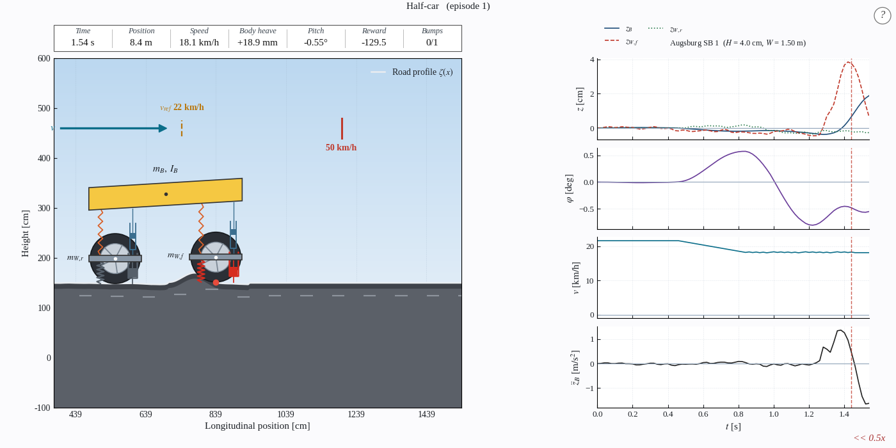

# Comfort-Aware Speed Planning over Speed Bumps

Recommended-speed baselines for passenger comfort over speed bumps. A PPO agent
and a model-predictive controller each read the road ahead and recommend a speed
for crossing every bump; the result is scored with ISO 2631-1 against the speed the
human driver actually drove. The two planners are independent of each other.



## Overview

The planner is trained with PPO on a nonlinear vehicle simulation wrapped in a
Gymnasium environment. Two plant models are available:

- **Half-car** (default): 4 degrees of freedom, heave and pitch, with separate
  front and rear axles. The rear axle rides the road one wheelbase behind the
  front.
- **Quarter-car**: 2 degrees of freedom, single-axle heave only. It shares the reward,
  action mode and scenarios with the half-car (select with `--vehicle quarter`); the
  original thesis implementation is kept at the git tag `thesis-quarter-car` (v1.0.2).

The vehicle dynamics use a nonlinear suspension (progressive spring with
bumpstops, asymmetric compression/rebound damping) integrated with RK4. The
reward puts ride comfort first: it penalises body vertical and pitch
acceleration, with secondary terms for longitudinal jerk and throttle
smoothness. The policy outputs a recommended speed between an 8 km/h floor and the scenario
speed, which a follower tracks, so it learns how much to slow for each obstacle
from the comfort terms and a controlled average speed, without using the MPC.

Training uses a four-level performance-gated curriculum over randomised roads.
A model-based MPC planner and rule-based drivers are included as baselines.

## Installation

Python 3.10 or newer and [just](https://github.com/casey/just) (`cargo install just`, `pip install rust-just` or a package manager) are required.

```bash
just install          # creates .venv, installs CPU PyTorch, the dependencies and the package
just lint             # the static check CI runs
```

PyTorch comes from the CPU wheel index first; nothing here uses a GPU. The remaining
dependencies are listed in `requirements.txt` (Gymnasium, Stable-Baselines3, NumPy, SciPy,
Numba, Matplotlib, TensorBoard).

### acados (MPC baseline only)

The MPC uses [acados](https://github.com/acados/acados), included as a git submodule.
It needs cmake and a C compiler:

```bash
git submodule update --init --recursive
just build-acados     # builds acados/ and installs its Python interface
```

The first MPC run downloads acados' template renderer from GitHub, so it needs network access once.
The RL agent, the rule-based driver and the evaluation do not require acados.

## Docker

Run the whole project in a container without installing anything locally.
The container runs as a non-root user matching your host UID/GID, so files it
writes to the mounted `logs/` and `data/` folders stay owned by you:

```bash
mkdir -p logs data
export LOCAL_UID=$(id -u) LOCAL_GID=$(id -g)
docker compose build
docker compose run --rm planner            # opens a shell with everything installed
```

Inside the container:

```bash
just train
just eval PPO <run-name>
just mpc                                    # requires acados (see below)
```

Training scenarios are generated during the image build. Logs and evaluation
data are written to `./logs` and `./data` on the host through mounted volumes.
Rendering is headless in the container (`MPLBACKEND=Agg`); use `--save-plots`
or `--save-gif` to capture output. The acados MPC baseline needs the acados
library, which is not included in the image.

## Scenarios

The synthetic evaluation suites (`config/eval/scenarios/0*`, `10_potholes`) are part of the repository.
The measured (real) roads extend the [CARD dataset](https://huggingface.co/CARD-Data) and are hosted on
HuggingFace as [CALM-Dataset/CALM-Scenarios](https://huggingface.co/datasets/CALM-Dataset/CALM-Scenarios)
(German part CC BY 4.0, Italian part CC BY-NC 4.0), not committed to the repository.
The recorded drives used for the human profile (`CALM_SEQUENCES`) come from the CALM-Germany and
CALM-Italy sequence datasets.

The scenarios are gated: request access on the dataset page (agreeing to its license
and usage terms), then authenticate locally before downloading:

```bash
hf auth login                   # once, with a token from huggingface.co/settings/tokens
just fetch-scenarios            # writes config/train/scenarios/real and config/eval/scenarios/{real,real_train}
```

The procedural training scenarios are generated locally, not stored anywhere:

```bash
just gen-scene                  # writes config/train/scenarios/curriculum
```

`just build-index` writes `config/dataset/index.json`, a metadata table over
every scenario (source, size, bump count, recommended speeds).

## Usage

Every `just` recipe is a thin wrapper over the `calm` command (`.venv/bin/calm --help` lists them), so use either.

```bash
just doctor                     # check Python, packages, acados, data and login, with hints
just train --run-name demo      # PPO through the 4-level curriculum (half-car)
just train --vehicle quarter    # quarter-car plant (same reward and settings)
just eval demo --render         # evaluate logs/models/PPO/demo/PPO_final.zip
just mpc --render               # MPC baseline
just reactive-driver --render   # rule-based driver baseline

just tb                         # TensorBoard
just tune --trials 50           # Optuna hyperparameter search
just test                       # fast tests, no data needed
```

A first run without any data: `just install`, `just doctor`, `just gen-scene`, then
`just train --timesteps 200000 --run-name demo` (a few minutes) and `just eval demo --scenario c`.

The vehicle at evaluation time must match the one the model was trained on (`--vehicle`).

### Render controls

- `space` pause, `f` / `s` faster / slower playback (starts at 0.5x)
- `+` / `-` or scroll wheel zoom, `0` reset zoom
- Left / right arrow: previous / next scenario

## Repository layout

```
src/gym_env/common/       environment, reward, wrappers and renderer shared by both vehicles
src/gym_env/half_car/     half-car plant (heave and pitch): ODE, parameters, drawing
src/gym_env/quarter_car/  quarter-car plant (heave): ODE, parameters, drawing
src/gym_env/vehicles.py   vehicle registry behind --vehicle half|quarter
src/train/        PPO training, curriculum, callbacks
src/eval/         evaluation, ISO 2631 comfort score, plotting
src/baseline/     MPC and rule-based baselines; runner.py holds the loops they share
src/road/         road profile generation
src/utils/        scenario generation, dataset index and helpers
config/           reward, curriculum, preview, scenario and evaluation configuration
tests/            fast tests (no data or GPU needed)
```

## Vehicle dynamics

The quarter-car body/wheel model:

```
m_B z̈_B = -F_spring(z_W - z_B) - F_damp(ż_W - ż_B)
m_W z̈_W =  F_spring + F_damp - F_tyre(z_W - ζ)
```

The half-car adds a pitch degree of freedom about the centre of mass and a
second axle, with load transfer coupling the front and rear suspension.

## License

See `LICENSE`.
