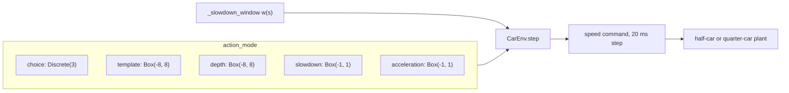

# Action space

The environment has five action modes. They differ in what the action means, how often the agent acts and who decides when to slow down. The final setup uses `choice`.



## This implements

- Five modes in `CarEnv.step` (`src/gym_env/common/car_env.py`), selected by `action_mode` in `config/gym_env/env.yaml` or by the `action_mode` argument of the environment.
- `DecisionWrapper` (`src/gym_env/common/wrappers/decision.py`): one agent step per slowdown window, `choice` only.
- `ActionRepeat` (`src/gym_env/common/wrappers/action_repeat.py`): repeats each action for several control steps, added only when `action_repeat` is above 1.
- `ActionSaturationPenalty` (`src/train/environment.py`): optional training penalty for actions outside the bounds.
- The slowdown window `_slowdown_window`, shared by `choice` and `template`.

## Modes at a glance

| Mode | Space | What the action sets | Who times the slowdown | Agent acts |
|---|---|---|---|---|
| `choice` | `Discrete(3)` | one of three slowdown depths, held for the whole window | the environment (window) | once per bump |
| `template` | `Box(-8, 8)` | a continuous depth, multiplied by the window | the environment (window) | every 20 ms step |
| `depth` | `Box(-8, 8)` | a continuous depth, no window | the agent | every 20 ms step |
| `slowdown` | `Box(-1, 1)` | how far the target speed drops below the scenario speed; positive values do nothing | the agent | every 20 ms step |
| `acceleration` | `Box(-1, 1)` | the acceleration as a fraction of `a_max` | the agent | every 20 ms step |

$v_\text{top}$ is the scenario speed, $v_\text{floor}$ the lowest allowed speed (`v_hard_min`, 5 km/h, or `speed_floor_ratio` times $v_\text{top}$ if that is larger). Every mode except `acceleration` sets a target speed and drives to it with a proportional controller:

$$a = \mathrm{clip}\big(k_v\,(v_\text{target} - v),\ -a_\max,\ a_\max\big), \qquad v \leftarrow \mathrm{clip}\big(v + a\,\Delta t,\ v_\text{floor},\ v_\text{top}\big)$$

with $k_v$ = `speed_gain`, $\Delta t$ = 20 ms. The speed never exceeds $v_\text{top}$, so the agent cannot speed up past the scenario speed in any mode.

## choice

Three depths from `choice_depths`: 0.0, 0.65, 0.85.

| Action | Depth $d$ | Target speed inside the window |
|---|---|---|
| 0 | 0.0 | $v_\text{top}$, no slowdown |
| 1 | 0.65 | 65 % of the way from $v_\text{top}$ to $v_\text{floor}$ |
| 2 | 0.85 | 85 % of the way from $v_\text{top}$ to $v_\text{floor}$ |

$$v_\text{target} = v_\text{top} - (v_\text{top} - v_\text{floor})\; d\; w(s)$$

$w(s) \in [0, 1]$ is the window weight at the front axle position $s$: a smoothstep $3r^2 - 2r^3$ of a linear ramp $r$. With several bumps $w$ is the largest of the single windows, so between two close bumps it never closes and one choice covers both.

- `reset` drives with the hold action (0) until the first window opens and returns that observation.
- The action is read on the first step with $w > 0$ and held until $w$ is 0 again. Actions at other times do not count.
- `step(action)` repeats the action every 20 ms until the next window opens or the episode ends.
- The agent reward is the sum of the 20 ms rewards, including the ones collected during `reset`.
- A road without a bump ends during `reset`; the next `step` returns the stored result.

## template

Box action $u \in [-8, 8]$. The depth is a sigmoid of $u$ times the same window as `choice`:

$$d = \frac{1}{1 + e^{-\text{slope}\,(u - \text{offset})}}\; w(s), \qquad v_\text{target} = v_\text{top} - (v_\text{top} - v_\text{floor})\, d$$

`depth_slope` and `depth_offset` default to 2.0, so $u = -8$ gives a depth of almost 0 and $u = 8$ almost 1. The agent chooses the depth continuously at every step, the window decides where it may act. There is no `DecisionWrapper`: the agent steps every 20 ms.

## depth

Same sigmoid depth as `template` without the window, so the agent decides both when and how deep:

$$d = \frac{1}{1 + e^{-\text{slope}\,(u - \text{offset})}}, \qquad v_\text{target} = v_\text{top} - (v_\text{top} - v_\text{floor})\, d$$

## slowdown

Box action $u \in [-1, 1]$. Only negative values act:

$$v_\text{target} = v_\text{top} + (v_\text{top} - v_\text{floor})\,\min(u, 0)$$

So $u = -1$ targets $v_\text{floor}$, $u = 0$ and above target $v_\text{top}$. No window. With the training penalty on (`action_saturation_penalty` above 0), `ActionSaturationPenalty` uses an upper bound of 0 for this mode, so positive actions are penalized.

## acceleration

Box action $u \in [-1, 1]$, the acceleration is $u\,a_\max$. There is no target speed and no speed controller, only the clip to $[v_\text{floor}, v_\text{top}]$ with $v_\text{floor}$ = `v_hard_min`. The [MPC-Planner](MPC-Planner) and the [Reactive-Driver](Reactive-Driver) run in this mode, because they output accelerations.

## Hold action

What the environment uses when no agent action is available (during `reset` and while the window is closed):

| Mode | Hold action |
|---|---|
| `choice` | 0 (no slowdown) |
| `template`, `depth` | $-8$ (depth about 0) |
| `slowdown`, `acceleration` | 0 |

## Parameters

In `config/gym_env/env.yaml`: `[min, max, default]`.

<details><summary>Parameter list</summary>

- `action_mode`: one of `choice`, `template`, `depth`, `slowdown`, `acceleration` [-, -, `choice`]
- `choice_depths`: depth of each `choice` action, as fraction of the way to the floor [0, 1, `[0.0, 0.65, 0.85]`]
- `speed_gain`: $k_v$ of the speed controller in 1/s [0, inf, 2.0]
- `depth_offset`, `depth_slope`: sigmoid of `depth` and `template` [-, -, 2.0, 2.0]
- `window_lead_far`: the window starts to open this far before the bump start $x_0$, in m [0, inf, 25.0]
- `window_lead_near`: fully open this far before $x_0$, in m [0, `window_lead_far`, 8.0]
- `window_after`: stays open until $x_0 + L + \ell +$ this, in m, with $L$ the bump length and $\ell$ the wheelbase [0, inf, 1.5]
- `window_release`: closes over this distance, in m [0, inf, 4.0]
- `speed_floor_ratio`: raises the floor to this fraction of $v_\text{top}$ in `slowdown`, `depth`, `template` and `choice` [0, 1, 0.0]
- `action_repeat`: control steps per agent action; the wrapper is only added above 1 [1, inf, 1]
- `velocity.v_hard_min` in `config/reward/reward.yaml`: the floor, km/h [0, inf, 5]
- `velocity.a_max` in `config/reward/reward.yaml`: m/s² [0, inf, 5]
- `action_saturation_penalty` (training meta): coefficient of the penalty on actions outside the bounds [0, inf, 0.0]
</details>

## Basic use

Set the mode in `config/gym_env/env.yaml`, or for one environment:

```python
import gymnasium as gym
env = gym.make("gym_env/HalfCar", action_mode="depth")
```

- The policy and the evaluation must use the same mode: a `Discrete(3)` policy does not run in a `Box` environment.
- `calm train` and `calm eval` read the mode from the yaml. The published CALM-PPO uses `choice`.
- `calm mpc` and `calm reactive` force `acceleration` for their own environment, whatever the yaml says.

See also: [Gymnasium-Environment](Gymnasium-Environment), [Observation-Space](Observation-Space), [PPO-Training](PPO-Training)
