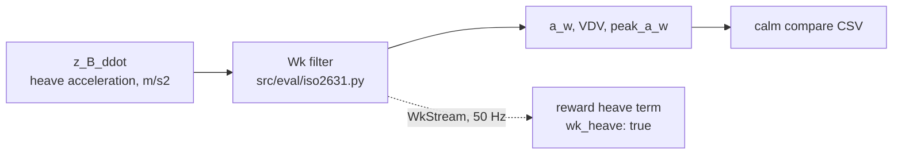
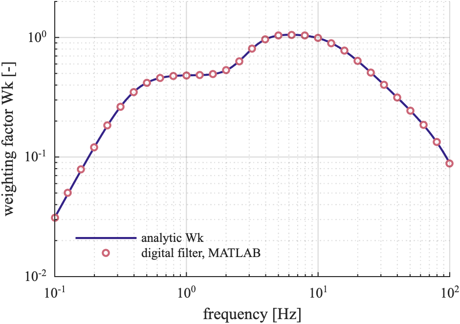

# Comfort metric

The ISO 2631-1 Wk weighting as CALM implements it, and where `a_w` and VDV are computed.



## This implements

- `wk_transfer_function`, `wk_magnitude`, `WkStream`, `weight_wk`, `rms`, `vdv`, `iso_band` in `src/eval/iso2631.py`
- `calm compare` in `src/eval/comfort_score.py`: replay of a speed profile and the output columns
- `WkStream` in the reward (`src/gym_env/common/car_env.py`) when `wk_heave` is true in `config/reward/reward.yaml`
- a test against the standard's table: `tests/comfort/test_iso2631.py` (absolute tolerance 0.005)

Filter: analogue `Wk(s)` from a second-order band limit (high pass `f1`, low pass `f2`, Butterworth), the acceleration-velocity transition (`f3`, `f4`, `Q4`) and the upward step (`f5`, `f6`, `Q5`, `Q6`, gain `K`), with `w = 2 pi f`:

```
Wk(s) = s^2 w2^2 * w4^2 (s/w3 + 1) * K (s^2/w5^2 + s/(Q5 w5) + 1)
        / [ (s^2 + sqrt2 w1 s + w1^2)(s^2 + sqrt2 w2 s + w2^2)(s^2 + w4/Q4 s + w4^2)(s^2/w6^2 + s/(Q6 w6) + 1) ]
```

`f1` 0.4 Hz, `f2` 100 Hz, `f3` 12.5 Hz, `f4` 12.5 Hz, `Q4` 0.63, `f5` 2.37 Hz, `f6` 3.35 Hz, `Q5` 0.91, `Q6` 0.91, `K` 0.5. The digital filter is the bilinear transform of zeros, poles and gain (`signal.bilinear_zpk`, no pre-warping) as second-order sections.

<p align="center">
  <br>
  <em>Wk weighting factor against frequency: analytic transfer function and the digital filter of ride-models-matlab.</em>
</p>

Definitions as coded, with `w_k` the Wk-weighted heave acceleration and `dt` = 0.02 s:

```
a_w      = sqrt( mean(w_k^2) )          over the measured span
VDV      = ( sum(w_k^4) * dt )^(1/4)
peak_a_w = max(|w_k|)
```

- `z_B_ddot`: heave acceleration of the half-car body, m/s2; no seat transfer function
- `pitch_rms`: unweighted RMS of the pitch acceleration
- `band`: label of `a_w`: below 0.315 not uncomfortable, 0.63 a little, 1.0 fairly, 1.6 uncomfortable, 2.5 very, above extremely
- `WkStream(dt)`: one sample at a time at 50 Hz, starts at the steady state of the first sample
- `weight_wk(x, dt)`: whole signal, upsample by 10 with `resample_poly`, filter, keep every tenth sample, starts at steady state so a constant offset does not ring

## Inputs and outputs

Reads: one speed per 0.02 s per road and driver. `replay` drives it through one half-car with `scoring_vehicle` of `config/eval/comfort.yaml` (`k_S_scale` 1.06, `D_scale` 0.16; `--uncalibrated` uses the nominal car) and collects `z_B_ddot` and the pitch acceleration. The span ends where the car reaches the end point of the road, or where the recorded human drive ends, whichever is earlier.

Writes, per road and driver, `a_w`, `vdv`, `peak_a_w`, `pitch_rms`, `band`, and for the human drive `a_w_imu`: the same weighting on the measured vertical acceleration of the recording, minus its mean, at the IMU sampling interval. Full column list on [Evaluation](Evaluation).

> [!WARNING]
> The `rms_accel` and `comfort_score` that `calm eval`, `calm mpc` and `calm reactive` print are not ISO values. `rms_accel` is the unweighted RMS of `z_B_ddot`, `comfort_score` is `max(0, 1 - rms_accel / a_limit)` with `a_limit` 5 m/s2. Use `calm compare` for `a_w`.

See also: [Evaluation](Evaluation), [Reward function](Reward-Function), [Half-car model](Half-Car-Model)
