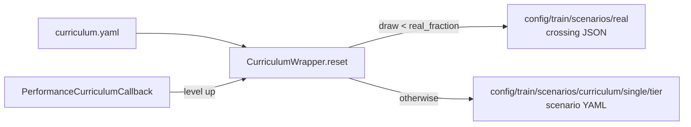

# Curriculum

Four difficulty levels for PPO training: each level owns a pool of generated single-obstacle roads, and 60 % of the episodes are real crossings at every level.

## This implements

- `CurriculumWrapper` (`src/gym_env/common/wrappers/curriculum.py`): draws the road at each `reset`, holds the level
- `PerformanceCurriculumCallback` (`src/train/monitoring.py`): evaluates, saves the best model per level, advances the level
- `calm gen-scenes` (`src/utils/generate_train_scenarios.py`): builds the generated pools
- a level only goes up; the real pool is cumulative over the levels reached

## Levels

Config `config/curriculum/curriculum.yaml`. Default `mode` is `timesteps`; a decision is one agent step, one per bump.

| Level | Tier | `timesteps` mode: advances at decision | `reward` mode: advances at mean evaluation return |
|---|---|---|---|
| 0 | `easy` | 5000 | 120.0 |
| 1 | `medium` | 10000 | 105.0 |
| 2 | `hard` | 15000 | 150.0 |
| 3 | `expert` | final level | final level |

- `advance_window`: evaluations averaged in `reward` mode [6]
- `advance_min_steps`: decisions a level lasts at least in `reward` mode [3500]
- `real_fraction`: share of episodes drawn from real crossings [0.6]
- `scenarios_dir`, `real_scenarios_dir`: [`config/train/scenarios/curriculum`, `config/train/scenarios/real`]

## Scenario sets

- Real: a crossing JSON from `real_scenarios_dir` with its recorded camera detections ([Dataset format](Dataset-Format)). `calm fetch` fills the folder. A `curriculum.json` there (entries with `file`, `difficulty`) assigns crossings to tiers; `calm fetch` does not write one, so with fetched data the whole real pool is open from level 0.
- Generated: `scenario_001.yaml` and so on, one folder per tier under `scenarios_dir`, one obstacle, a speed and a flat start. If the folder is missing, the environment falls back to its random road.

Generator `config/train/scenario_gen.yaml` (`calm gen-scenes`, also writes `config/train/scenarios/manifest.yaml`):

- `obstacle_mode`: `bumps`, `potholes` or `both`; `--mode` overrides [`bumps`]
- `per_level`: scenarios per tier [200]
- `v_min_kmh`, `v_max_kmh`: road speed range [15, 30]
- `flat_start_range`: meters of flat road before the obstacle [[10, 20]]
- `real_range.height_mm`, `real_range.width_m`: log-uniform sampling range of bumps, matched to the real crossings [[30, 120], [1.5, 7]]
- `real_range.samples`: sampled bumps [1500]
- `difficulty_thresholds`: upper limits of the tiers [easy 0.30, medium 0.57, hard 0.78, expert 1.01]

Difficulty = `0.6 * rank + 0.4 * speed_n`. `rank` is the position of the bump when all sampled bumps are ordered by height divided by width (0 flat and long, 1 steep and short). `speed_n` is the road speed scaled over 15 to 30 km/h. With `potholes` or `both` the ranks come from `bump_rank` and `pothole_rank` in the same file and the catalogs in `config/catalog/`.

## Logged

- console: `[Curriculum] Level a -> b` with window mean, threshold and step
- TensorBoard: `curriculum/level`, `curriculum/mean_return`, `real_val/mean_return`
- `summary.json`, key `curriculum`: per level `n_evals`, `mean_return`, `best_return`, `worst_return`, `step_unlocked`, `step_advanced`, `advance_threshold`, `mastered`

See also: [PPO training](PPO-Training), [Roads and bumps](Roads-and-Bumps), [Scenarios](Scenarios)
