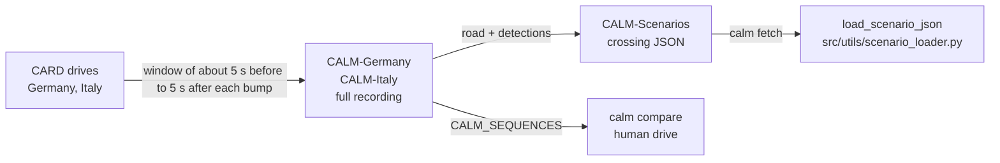
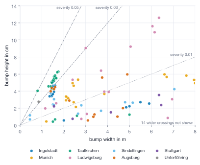
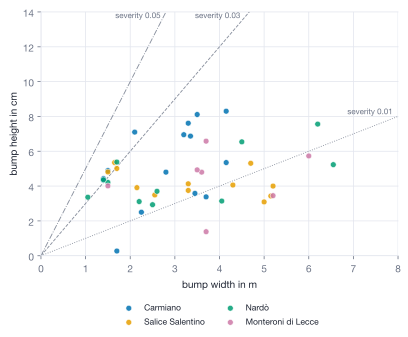

# Dataset format

File formats of the CALM datasets on Hugging Face: the crossing JSON in CALM-Scenarios and the folders of CALM-Germany and CALM-Italy.



<p align="center">
  <br>
  <em>A recorded crossing in the Rerun viewer: laser point cloud, both cameras, speed, wheel excitement and the GPS map.</em>
</p>

## This implements

- crossing JSON per qualified or low-confidence crossing: 114 German, 45 Italian; 105 qualified (64 and 41), 54 low confidence (50 and 4)
- perception model files with detection probability and range error per distance bin
- full recording per window with `meta.yaml`, `manifest.json` and `comfort_profiles`
- all four repositories are gated, CC BY-NC 4.0; the unchanged CARD material is CC BY 4.0 (Germany) and CC BY-NC 4.0 (Italy). Cite [CARD](https://huggingface.co/CARD-Data) and CALM.

## Inputs and outputs

CALM-Scenarios crossing, `germany/crossings/<name>.json` (for example `ingolstadt_sb01`), read by `load_scenario_json`:

- `road.ds_m`, `road.z`: spacing (0.05 m) and height in m from the trimmed start
- `bumps[]`: the first flagged bump only, with `s_bump_m`, `s_start_m`, `s_end_m`, `peak_z_m`, `width_m` (limited to the range of the road model) and `low_confidence`
- `perception.samples[]`: one entry per camera frame on the approach, with `d_true`, `detected`, `d_hat`, `bbox`; CALM reads `detected` and `d_hat`
- `meta.trim.offset_m`: length cut from the start, used to align the human drive

<details><summary>Fields CALM does not read</summary>

- `name`, `source_sequence`: crossing name and CARD recording (used for labels)
- `bumps[].raw_peak_z_m`, `raw_width_m`: measured values before limiting
- `bumps[].wheel_raw_peak_z_m`, `lidar_raw_peak_z_m`, `spans_both_wheels`, `front_track_width_m`
- `meta.ds_m`, `road_length_m`, `camera_height_m`, `anchor_us`, `window_us`, `units`
- `meta.trim.original_road_length_m`, `edge_tol_m` (1 cm), `bump_margin_m` (0.5 m)
</details>

Perception model, `perception_model_de_it.yaml` and one per country. Bins of `bin_width_m` = 1 m from 0 m, one list entry per bin:

- `max_range_m`: end of the last bin; beyond it the simulated camera never detects the bump
- `n_samples`, `n_ranged`: frames, and detections with a distance estimate
- `p_detect`: share of frames with a detection
- `range_bias`, `range_std`: mean and standard deviation of estimated minus true distance, m; `null` for a bin with fewer than 8 estimates (no error added)

CALM-Germany and CALM-Italy, same layout:

```
manifest.json                             n_windows; per crossing source_sequence, sb_count, span_s, item counts
sequences/<area>/<crossing>/
├── img/cam_0/, img/cam_1/                camera frames
├── agg_depth/cam_1/                      depth points per frame (.npz, pts_cam, N x 3)
├── labels/                               YOLO boxes per cam_1 frame, class 1 = speed bump
├── raw/gnss.ubx, raw/data.pcap           raw GNSS log and sensor packets
├── export/
│   ├── output.laz                        point cloud
│   ├── wheel_excitement.json             distance and contact point of each wheel
│   ├── output.laz.trajectory.json        pose of the car
│   └── output.laz.sensor_export.json     GPS and IMU samples
├── comfort_profiles/ppo.json, mpc.json   qualified crossings only
└── meta.yaml                             window and bump position in the source recording
```

- `meta.yaml`: `source_sequence`, `source_window_index`, `window_index`, `sb_count`, `encounter`, `anchor_ts`, `window`, `clipped_pre`, `clipped_post`, `s_bump`, `s_span`, `contents`
- `comfort_profiles/*.json`: `vehicle`, `source` (`ppo` or `mpc`), `travel_time_s`, `samples` (`t_s`, `s_m`, `v_kmh` every 0.02 s)
- `wheel_excitement.json`: per wheel (`cariad_wheel_FL`, `_FR`, `_RL`, `_RR`) rows of two timestamps, distance and vertical excitation, plus `contact_point_trajectory.poses`
- timestamps are microseconds on the recording clock; five German and four Italian crossings have no `data.pcap` (`meta.yaml`: `pcap: unavailable`)

## Basic use

```bash
export CALM_SEQUENCES=/data/CALM-Germany/sequences:/data/CALM-Italy/sequences
calm compare demo --suites real
```

- `CALM_SEQUENCES`: colon-separated `sequences` folders; `calm compare` rebuilds the human drive from the front wheel contact points. `--real-root` does the same per run.
- the split and the placement of the crossing files are on [Scenarios](Scenarios)

<table>
  <tr>
    <td align="center"></td>
    <td align="center"></td>
  </tr>
  <tr>
    <td align="center"><em>Germany</em></td>
    <td align="center"><em>Italy</em></td>
  </tr>
</table>
<p align="center"><em>Height against width of the recorded crossings by area; the dotted lines mark constant severity (height divided by width).</em></p>

See also: [Scenarios](Scenarios), [Evaluation](Evaluation), [Roads and bumps](Roads-and-Bumps)
