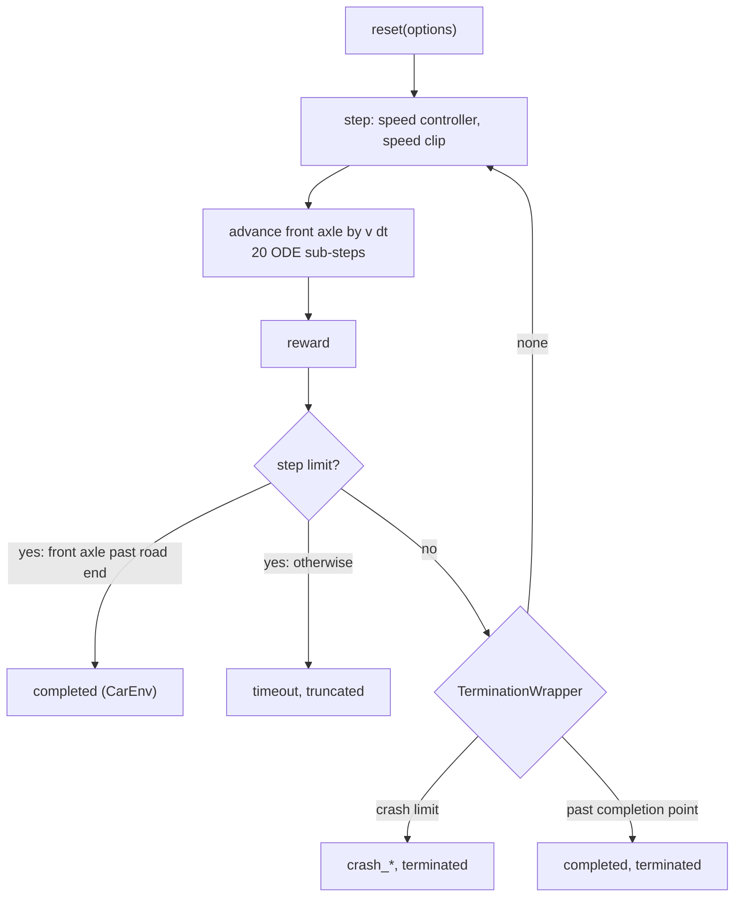

# Episodes and termination

One episode is one drive over one road, from the start of the road to a point behind its last bump. The step is 20 ms (`DT`), the vehicle model runs 20 RK4 sub-steps of 1 ms inside it.

## This implements

- `reset` and `step` in `src/gym_env/common/car_env.py`. `CarEnv` ends an episode only at the step limit.
- Crash limits and the completion point in `TerminationWrapper` (`src/gym_env/common/wrappers/termination.py`).
- Parameters read by `src/gym_env/common/env_params.py` from `config/gym_env/env.yaml`.

## Inputs and outputs

`reset(seed=None, options=None)`:
- `options={"road": road}`: the given road; top speed and start speed are the road speed.
- no options and `random_road_on_reset=True`: one catalog bump with a flat run-up of at least 60 m and at least $v^2/(2 a_\max)$. Road speed $v$ drawn from 16 to 35 km/h (`2 * v_min` to `v_limit`), top speed $v_\text{top}$ drawn from 8 to 35 km/h (`v_init_low` to `v_limit`), start speed $\min(v, v_\text{top})$, at least 5 km/h.
- `options={"randomize_road": False}`: the current road, restarted. Road speed `vehicle_speed` (6 m/s), $v_\text{top}$ drawn as above, start speed $\min(6\ \text{m/s}, v_\text{top})$.
- All vehicle states are zero (static equilibrium) except the speed. The curriculum always passes a road, so the random road is a fallback.

`step` returns `terminated`, `truncated` and `info["termination_reason"]`:

| `termination_reason` | Condition | Flag | Terminal reward |
|---|---|---|---|
| `completed` | front axle past the completion point | terminated | +100 |
| `crash_susp` | suspension travel above 0.20 m (larger of front and rear) | terminated | -250 |
| `crash_body` | body heave displacement above 0.40 m | terminated | -250 |
| `crash_damper` | damper velocity above 10 m/s (larger of the two axles) | terminated | -250 |
| `crash_speed` | speed below 0 or above 18.1 m/s | terminated | -250 |
| `timeout` | step limit reached before the end | truncated | -250 |

The crash checks run in this order, the first that fires sets the reason.

| Road | Completion point |
|---|---|
| recorded profile | last profile point + wheelbase + 3 m |
| bump list (generated or YAML) | end of the last bump + run-out + `POST_BUMP_MARGIN` |

The run-out is 40 m on the YAML evaluation scenarios (`EVAL_RUNOUT_M`) and 0 on training roads. At the step limit `CarEnv` marks `completed` itself if the front axle is past the end of the road (profile: last point + wheelbase + 3 m; bump list: end of the last bump + run-out + wheelbase), otherwise `timeout`.

## Parameters

In `config/gym_env/env.yaml`: `[min, max, default]`.

Parameter list

- `DT`: control step in s [0, inf, 0.02]
- `DT_SIM`: integration step in s, 20 sub-steps per control step [0, `DT`, 0.001]
- `EPISODE_STEPS`: step limit, 80 s [1, inf, 4000]
- `TRUNC_SUSP_TRAVEL`: limit of `crash_susp` in m [0, inf, 0.20]
- `TRUNC_BODY_DISP`: limit of `crash_body` in m [0, inf, 0.40]
- `TRUNC_DAMPER_VEL`: limit of `crash_damper` in m/s [0, inf, 10.0]
- `POST_BUMP_MARGIN`: distance after the last bump in m [0, inf, 15.0]
- `POST_BUMP_MARGIN_MATCH_FLAT_START`: margin equals the start of the first bump [False, True, False]

The speed limits of `crash_speed` are `terminal.v_min` and `terminal.v_max` in `config/reward/reward.yaml`.

See also: [Gymnasium-Environment](Gymnasium-Environment), [Action-Space](Action-Space), [Reward-Function](Reward-Function), [Roads-and-Bumps](Roads-and-Bumps), [Evaluation](Evaluation)
