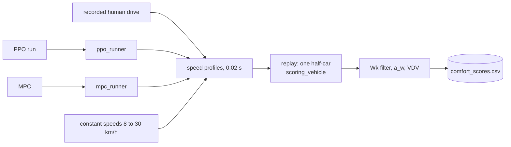
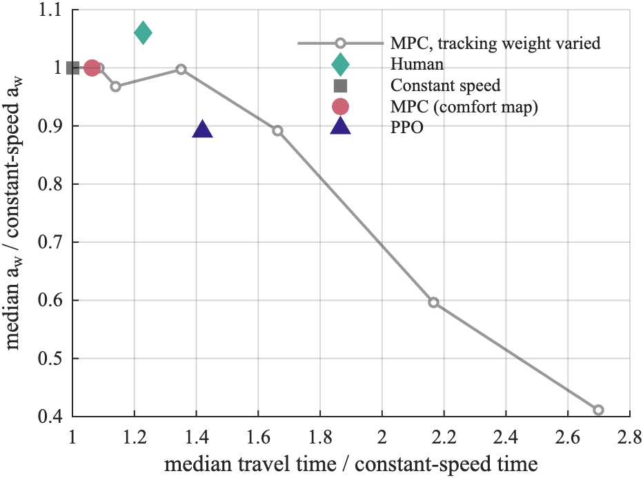

# Evaluation

`calm eval` runs a policy in its own environment and reports reward terms. `calm compare` replays the speed profile of each driver through one calibrated half-car and measures ISO 2631-1 comfort.



## This implements

- `calm eval <run> [checkpoint]`: deterministic evaluation of `logs/models/PPO/<run>/<checkpoint>`, default `PPO_final.zip` (a `.safetensors` file also works)
- `calm compare <run> [checkpoint]`: PPO, MPC, constant speed and human on the chosen suites; always runs the MPC (`src/eval/comfort_score.py`, `src/eval/runners.py`)
- `calm reproduce`: trains seeds, then runs the comparison for each; `just eval`, `just compare`, `just reproduce` call the same commands
- `a_w_vs_const_pct`, the comfort change against a constant-speed drive of equal travel time

## Inputs and outputs

`calm compare` reads:
- a trained run, the MPC config, the suites
- the recordings for the human drive: `CALM_SEQUENCES` or `--real-root` ([Dataset format](Dataset-Format)); the drive is the front left wheel distance against time from `wheel_excitement.json`, resampled to 0.02 s, differentiated with a Savitzky-Golay filter (1 s window, cubic), negative speeds set to 0, start shifted by `offset_m`. If the recording ends first, the last speed (at least 0.5 m/s) is held and `padded_frac` records the share.

`calm compare` writes `logs/comfort/comfort_scores.csv`, one row per road and driver:

<details><summary>Columns</summary>

- `suite`, `scenario`
- `source`: `const`, `human` (real roads), `ppo`, `mpc`
- `a_w`, `vdv`, `peak_a_w`, `pitch_rms`: comfort measures ([Comfort metric](Comfort-Metric))
- `mean_speed_kmh`, `min_speed_kmh`, `travel_time_s`: over the span
- `completed`: the car reached the end of the road
- `band`: ISO label of `a_w`
- `a_w_imu`, `padded_frac`: human only
- `a_w_vs_const_pct`: defined below
- `split`: `seen` (in `real_train`), `unseen` (in `real`), empty otherwise
</details>

`calm eval` writes JSON under `logs/eval/results/`: `eval_PPO_suite_<exp_n or run>/suite_PPO_<time>.json` for suites, `eval_PPO_<scenario>_<exp_n or run>/eval_PPO_<time>.json` for one road (`aggregate`, `per_episode`). Per episode: `total_return`, `n_steps`, `rms_accel`, `peak_accel`, `rms_pitch_accel`, `speed_rmse`, `mean_speed`, `comfort_score`, `action_rms`, `action_smoothness_rms`, `bumps_passed`, `bumps_total`, `holes_passed`, `holes_total`, `termination_reason`, and the summed reward terms `total_J_heave`, `_wheel`, `_long_acc`, `_long_jerk`, `_long_vel`, `_pitch`.

Equal-time metric. For a drive over the measured span of a road, with travel time `T` and weighted RMS `a_w`:

```
a_w_vs_const_pct = 100 * ( a_w / a_w_const(T) - 1 )
```

- `a_w_const(v)`: `a_w` of a constant-speed drive at `v` over the same span, for `v` = 8, 10, ... , 30 km/h
- `a_w_const(T)`: the constant-speed curve interpolated linearly at the travel time `T`; outside 8 to 30 km/h the nearest end value
- negative means smoother than a constant-speed drive that spends the same time on the road
- the span ends at the last profile point plus a wheelbase plus 3 m on recorded roads, at the end of the last obstacle plus a wheelbase plus a 40 m run-out on synthetic roads (flat roads are 200 m), and where the human drive ends if that is earlier

<p align="center">
  <br>
  <em>Median a<sub>w</sub> and median travel time of the human drive, constant speed, MPC and PPO, each relative to constant speed, with a sweep of the MPC tracking weight.</em>
</p>

## Basic use

```bash
calm eval demo --suites real --n-episodes 5
calm compare demo --suites real real_train --mpc-objective frontier
calm reproduce --seeds 69 70 --prefix repro
```

`calm eval`:
- `--scenario`: name or path; without it the suites of `config/eval/eval_suites.yaml` run
- `--suites`: folders, `real`, `real_train`, `real_all`, `flat`
- `--n-episodes` [5], `--seed` [0], `--vehicle`, `--render`, `--save-plots`, `--save-gif`

`calm compare`:
- `--suites`: [every synthetic suite except potholes, and `real`]
- `--mpc-objective`: `comfort_map` or `frontier` [`comfort_map`]
- `--horizon`: MPC steps [`N` of `mpc.yaml`]
- `--real-root`: folder with recorded windows, repeatable
- `--uncalibrated`: nominal half-car instead of the calibrated one
- `--allow-missing-human`: do not stop when a real road has no recording
- `--seed` [0], `--out` [`logs/comfort/comfort_scores.csv`]

`calm reproduce`: `--seeds` [69 to 73], `--timesteps`, `--prefix` [`repro`, runs are `<prefix>_s<seed>`], `--suites` [`real_all`], `--skip-train`, `--dry-run`. Output `logs/comfort/runs/<run>.csv`. Only the first seed also runs the MPC.

> [!NOTE]
> A `.safetensors` policy makes `calm eval` build the half-car environment and look for `vecnormalize.json` in the same or a parent folder. In `calm compare` the PPO policy runs with the road's camera detections attached when `perception_mode` allows (CALM-PPO: `none`), the MPC on the true road.

> [!TIP]
> To add a controller write `run(road, track)` returning `(speeds, comfort, rms_accel)`, one speed in m/s per 0.02 s. Only `speeds` is replayed. `ppo_runner` and `mpc_runner` in `src/eval/runners.py` are the examples, `score_scenario` takes a dictionary of runners.

See also: [Comfort metric](Comfort-Metric), [Scenarios](Scenarios), [MPC planner](MPC-Planner), [PPO training](PPO-Training)
