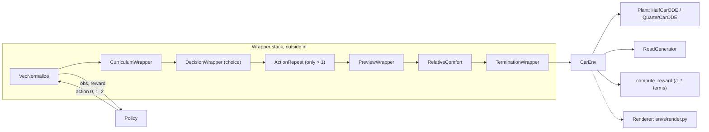

# Gymnasium environment

`CarEnv` is the CALM simulator as a Gymnasium environment: one vehicle model driving over one road at a speed the agent controls.



## This implements

- `CarEnv` (`src/gym_env/common/car_env.py`): reset, step, speed controller, `info`.
- Two registered ids: `gym_env/HalfCar` (default) and `gym_env/QuarterCar`, subclasses in `src/gym_env/half_car/envs/` and `src/gym_env/quarter_car/envs/`.
- `VEHICLES` registry and `get_vehicle(name)` in `src/gym_env/vehicles.py`.
- Wrappers in `src/gym_env/common/wrappers/`: `termination.py`, `relative_comfort.py`, `decision.py`, `action_repeat.py`, `curriculum.py`. `PreviewWrapper` is in `src/gym_env/common/preview/preview.py`.
- Stack builders: `src/train/environment.py` (training, with `VecNormalize`) and `_build_env` in `src/eval/eval.py` (evaluation: `CarEnv`, `TerminationWrapper`, `PreviewWrapper`, `DecisionWrapper`, frozen statistics).

## Inputs and outputs

`step(action)` takes:
- an integer 0, 1 or 2 in the final setup (`choice` mode, see [Action-Space](Action-Space)).

`step(action)` returns:
- `obs`: 23 values for the half-car, 21 for the quarter-car (see [Observation-Space](Observation-Space)).
- `reward`: sum of the 20 ms rewards of the decision (see [Reward-Function](Reward-Function)).
- `terminated`, `truncated`: see [Episodes-and-Termination](Episodes-and-Termination).
- `info`: keys below.

`reset(seed=None, options=None)` takes `options={"road": road}` (a `RoadGenerator`) or `options={"randomize_road": False}`. It returns the observation of the first slowdown window and an `info` dict.

<details><summary>info keys</summary>

- `speed`, `speed_kmh`, `v_init`, `v_init_kmh`: current speed, top speed of the episode.
- `step_count`, `episode_time`: 20 ms steps, simulated seconds.
- `z_B_ddot`, `z_W_ddot`, `phi_ddot`: body, front wheel, pitch acceleration of the last step, unweighted.
- `rms_accel`, `peak_accel`, `susp_defl`, `tire_defl`: running RMS and peak of the body acceleration, front suspension and tire deflection.
- `bumps_passed`, `bumps_total`, `holes_passed`, `holes_total`: obstacles behind the car and on the road.
- `J_heave`, `J_wheel`, `J_pitch`, `J_long_acc`, `J_long_jerk`, `J_long_vel`, `J_act_smooth`, `J_total`: weighted reward terms of the last step.
- `termination_reason`: `completed`, `timeout` or `crash_*`, set on the last step.

With the `DecisionWrapper`, `info` belongs to the last 20 ms step of the decision. `record_inner=True` adds `info["inner"]`, one entry per 20 ms step.
</details>

## Parameters

Constructor arguments of `gym.make(id, **kwargs)`: `[min, max, default]`. Defaults come from `config/gym_env/env.yaml`, `config/reward/reward.yaml` and `config/gym_env/render.yaml`.

<details><summary>Parameter list</summary>

- `vehicle_speed`: speed in m/s of the default road, used with `randomize_road: False` [0, inf, 6.0]
- `render_mode`: `'human'`, `'rgb_array'` or `'none'` [-, -, `'none'`]
- `physics_params`: overrides single vehicle parameters, see [Vehicle-Models](Vehicle-Models) [-, -, calibrated plant]
- `reward_config`: a `RewardConfig` [-, -, `config/reward/reward.yaml`]
- `random_road_on_reset`: draw a random one-bump road at each reset [False, True, True]
- `action_mode`: `choice`, `acceleration` and three older modes [-, -, `choice`]
- `max_episode_steps`: step limit, 20 ms each [1, inf, 4000]
- `render_y_scale`, `show_time_series`, `show_ts_z`, `show_ts_z_ddot`, `show_ts_speed`, `freeze_episode`: live window options from `render.yaml`, see [Simulator](Simulator)
</details>

## Basic use

Run with `PYTHONPATH=src`.

```python
import gymnasium as gym
from gym_env.vehicles import get_vehicle
from gym_env.common import PreviewWrapper, TerminationWrapper
from gym_env.common.wrappers.decision import with_decisions
from utils.scenario_loader import load_scenario_any

env = gym.make(get_vehicle("half").env_id)
env = with_decisions(PreviewWrapper(TerminationWrapper(env)))
road, track, speed, description = load_scenario_any("c")
obs, info = env.reset(seed=0, options={"road": road})
obs, reward, terminated, truncated, info = env.step(1)
```

- `get_vehicle("half")` imports the environment module, which registers the id.
- `with_decisions` adds the `DecisionWrapper` only for `action_mode: choice`.
- `load_scenario_any("c")` loads a scenario by key, see [Scenarios](Scenarios).

See also: [Action-Space](Action-Space), [Observation-Space](Observation-Space), [Reward-Function](Reward-Function), [Episodes-and-Termination](Episodes-and-Termination), [Roads-and-Bumps](Roads-and-Bumps), [Vehicle-Models](Vehicle-Models), [PPO-Training](PPO-Training)
