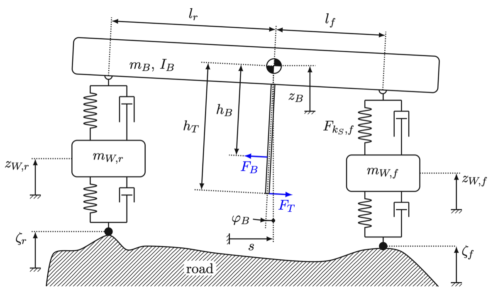

# Half-car model

`HalfCarODE` is the default vehicle: a planar side-view model with body heave and pitch and two wheels with heave.

   
  <em>Half-car: body mass mB and pitch inertia IB, axles at lf and lr from the centre of gravity, pitch lever arms hT and hB (from the BSc thesis).</em>

## This implements

- `HalfCarODE` in `src/gym_env/half_car/core/ode_model.py`: `_ode`, `_spring_nonlin`, `_damper`, `_rk4_loop`, `step`, `observe`, `crash_signals`.
- `BODY`, `PHYSICS_F`, `PHYSICS_R`, `PLANT_PARAMS` and the observation bounds in `src/gym_env/half_car/config/env_params.py`.
- `HalfCarEnv`, registration and rendering in `src/gym_env/half_car/envs/`.

State vector (11), displacements from static equilibrium, so gravity does not appear:

- 0, 2: tyre deflection rear, front [m]
- 1, 3: wheel vertical velocity rear, front [m/s]
- 4, 6: suspension deflection rear, front, wheel minus body at the axle, positive in compression [m]
- 5: body heave velocity [m/s]
- 7: pitch rate [rad/s]
- 8: speed $v$, no dynamics, set by the environment [m/s]
- 9: body heave displacement [m]
- 10: pitch angle, positive lowers the front [rad]

## Equations

For axle $i \in \{f, r\}$, suspension deflection $\delta_S$, its rate $v_S$, tyre deflection $\delta_T$:

$$F_{S,i} = k_{S,i}\,\delta_{S,i} + F^{nl}_{S,i}(\delta_{S,i}) + F_{C,i}(v_{S,i}), \qquad F_{T,i} = k_T\,\delta_{T,i} + c_T(\dot\zeta_i - \dot z_{W,i})$$

$$m_B\,\ddot z_B = F_{S,f} + F_{S,r}, \quad I_B\,\ddot\varphi = l_r F_{S,r} - l_f F_{S,f} - h\,m_{tot}\,a, \quad m_{W}\,\ddot z_{W,i} = F_{T,i} - F_{S,i}$$

- $a$ is the longitudinal acceleration of the step, $m_{tot} = m_B + 2 m_W$, $h = h_T$ for $a > 0$ and $h_B$ otherwise.
- $\dot\delta_{S,f} = \dot z_{W,f} - \dot z_B + l_f\dot\varphi$ and $\dot\delta_{S,r} = \dot z_{W,r} - \dot z_B - l_r\dot\varphi$.
- Bump stops $F^{nl}$: zero between $-d_r$ and $d_c$. Beyond, with excess $e$: $\pm k_S\big(\delta_{st} f_1 (e^{f_2 e/\delta_{st}} - 1) - e\big)$, clipped to $\pm F_{max}$. $\delta_{st}$ is the static deflection: $m_B\,g\,(l_r/L)/k_{S,f}$ front, $m_B\,g\,(l_f/L)/k_{S,r}$ rear.
- Damper $F_C$: slope $d_1 = A z_1$ in compression, $z_1 = 2D/(1+A)$ in rebound. Above $v_d$ in compression the slope becomes $d_1/0.25$, below $-v_z$ in rebound $z_1/0.40$. Slopes are blended with a logistic function (steepness 50).

## Inputs and outputs

`HalfCarODE.step(x, road, s, v, a)` takes:
- the state, the road, front axle position $s$ (rear wheel at $s - L$), speed $v$, acceleration $a$.

and returns:
- the new state; from the derivative at the end of the step the body acceleration, pitch acceleration, front and rear wheel acceleration.

`observe` gives the five body values of [Observation-Space](Observation-Space). `crash_signals` gives the three values checked in [Episodes-and-Termination](Episodes-and-Termination).

## Parameters

Values in `src/gym_env/half_car/config/env_params.py` (body, axles) and `config/gym_env/env.yaml` (the rest): `name`: meaning [min, max, default].

Parameter list

- `m_B`, `I_B`: body mass in kg, pitch inertia in kg m² [0, inf, 803, 1430]
- `l_f`, `l_r`: centre of gravity to front, rear axle in m, wheelbase $L$ = 2.870 [0, inf, 1.206, 1.664]
- `h_T`, `h_B`: pitch lever arm accelerating, braking, in m [0, inf, 0.600, 0.222]
- `m_W`: wheel mass in kg [0, inf, 50.4]
- `k_S` front, rear: suspension stiffness in N/m [0, inf, 27915, 20231]
- `D` front, rear: mean damping in N s/m [0, inf, 3530, 3515]
- `k_T`, `c_T`: tyre stiffness in N/m, damping in N s/m [0, inf, 262200, 500]
- `A`: compression to rebound damping ratio [0, 1, 0.5]
- `v_d`, `v_z`: damper knee velocities in m/s [0, inf, 0.2, 0.2]
- `dz_cmp`, `dz_rbd`: bump-stop clearances in m [0, inf, 0.02, 0.08]
- `f1_cmp`, `f2_cmp`: bump-stop shape, compression [0, inf, 1/3, 4]
- `f1_rbd`, `f2_rbd`: bump-stop shape, rebound [0, inf, 1, 8]
- `F_ks_nlin_max`: bump-stop force clip in N [0, inf, 100000]
- `plant_k_S_scale`, `plant_D_scale`: factors on $k_S$ and $D$ of both axles [0, inf, 1.06, 0.16]

The model that runs is the plant with the factors: $k_S$ 29 590 and 21 446 N/m, $D$ about 565 and 562 N s/m. They are the factors of the evaluation vehicle in `config/eval/comfort.yaml`, calibrated against IMU recordings on 13 scenarios.

## Integration

RK4 with `DT_SIM` = 1 ms, 20 sub-steps per 20 ms control step, speed constant. The road velocity under both wheels is sampled at the start, middle and end of each sub-step. The loop is compiled with Numba (`@njit(cache=True)`).

See also: [Vehicle-Models](Vehicle-Models), [Quarter-Car-Model](Quarter-Car-Model), [Roads-and-Bumps](Roads-and-Bumps), [Comfort-Metric](Comfort-Metric)
