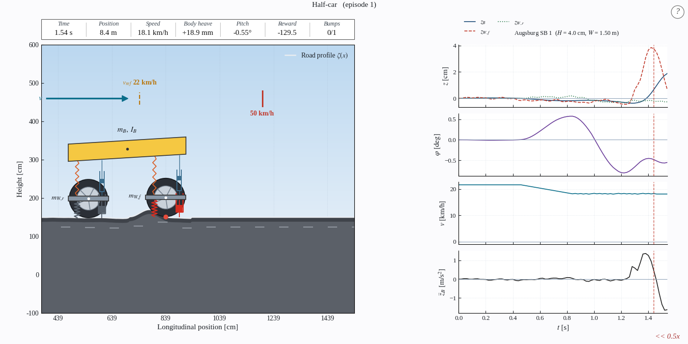
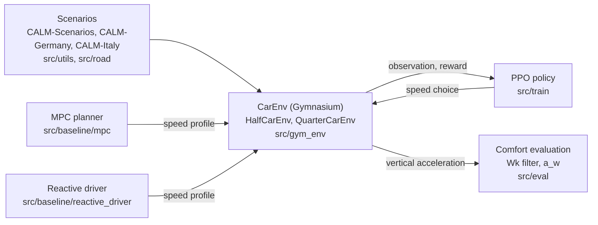

# CALM: Comfort-Aware Longitudinal Motion Planning


[](https://huggingface.co/CALM-Dataset)

<p align="center">
  <br>
  <em>The half-car simulator on a measured bump, with the live traces on the right. A GIF from <code>--save-gif</code> can replace this image.</em>
</p>

CALM recommends a crossing speed for every speed bump ahead. It simulates the ride in a half-car or quarter-car Gymnasium environment and judges it by the ISO 2631-1 weighted vertical acceleration.



## Pages

| Group | Pages |
|---|---|
| Getting started | [Getting started](Getting-Started), [Command line](Command-Line), [Simulator](Simulator) |
| Environment | [Gymnasium environment](Gymnasium-Environment): [Action space](Action-Space), [Observation space](Observation-Space), [Reward function](Reward-Function), [Episodes and termination](Episodes-and-Termination), [Roads and bumps](Roads-and-Bumps) |
| Vehicle models | [Vehicle models](Vehicle-Models): [Half-car model](Half-Car-Model), [Quarter-car model](Quarter-Car-Model) |
| Policy | [PPO training](PPO-Training): [Curriculum](Curriculum) |
| Planners | [MPC planner](MPC-Planner), [Reactive driver](Reactive-Driver) |
| Data | [Scenarios](Scenarios): [Dataset format](Dataset-Format) |
| Evaluation | [Evaluation](Evaluation): [Comfort metric](Comfort-Metric) |
| Help | [Troubleshooting](Troubleshooting) |

## Models and data

Hugging Face, CC BY-NC 4.0, access on request.

- [CALM-PPO](https://huggingface.co/CALM-Dataset/CALM-PPO): trained policies.
- [CALM-Scenarios](https://huggingface.co/datasets/CALM-Dataset/CALM-Scenarios): road files, split, synthetic roads.
- [CALM-Germany](https://huggingface.co/datasets/CALM-Dataset/CALM-Germany), [CALM-Italy](https://huggingface.co/datasets/CALM-Dataset/CALM-Italy): recorded crossings with raw sensor data.
- [ride-models-matlab](https://github.com/CALM-Dataset/ride-models-matlab): the ride models in MATLAB and Simulink.

## Citing CALM

```bibtex
@thesis{azab2026calm,
  title  = {Comfort-Aware Speed Planning over Road Anomalies: A Reinforcement-Learning Approach},
  author = {Mohammed El Said Azab Abdelazim},
  institution = {Technische Universit{\"a}t Berlin},
  type   = {Bachelor's thesis},
  year   = {2026}
}
```

```bibtex
@misc{calm_dataset,
  title  = {CALM: Comfort-Aware Longitudinal Motion Planning},
  author = {Mohammed El Said Azab Abdelazim},
  year   = {2026},
  url    = {https://huggingface.co/CALM-Dataset}
}
```

The real roads are built on the CARD recordings. Cite CARD too:

```bibtex
@inproceedings{elazab2025card,
  title     = {CARD: A Multi-Modal Automotive Dataset for Dense 3D Reconstruction in Challenging Road Topography},
  author    = {Elazab, Gasser and Neuhaus, Frank and Ko{\ss}, Tilman and Splietker, Malte and Date, Aditya and Unterreiner, Michael and Jansen, Maximilian and Hellwich, Olaf},
  booktitle = {Proceedings of the IEEE/CVF Conference on Computer Vision and Pattern Recognition (CVPR)},
  year      = {2026}
}
```

## Acknowledgement

- CARD, the recordings behind the real roads.
- acados, the solver of the MPC planner.
- Gymnasium and Stable-Baselines3, the environment API and the PPO implementation.
- ride-models-matlab, the MATLAB and Simulink version of the ride models.
