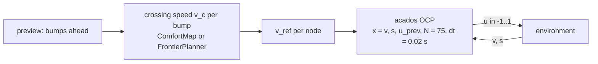

# MPC planner

The acados model predictive controller that CALM uses as the reference planner, built so it can be compared with the PPO policy on the same roads.



The half-car is not part of the online problem. The crossing speeds are chosen with it outside the control loop, the OCP tracks the resulting reference at every 20 ms step.

## This implements

- two objectives for the crossing speed: `comfort_map` (default) and `frontier`
- preview from the true road or from camera detections (`src/baseline/perceived_road.py`)
- `build_solver_simple` in `src/baseline/mpc/ocp.py`, `MPCController` in `controller.py`, `ComfortMap` in `comfort_map.py`, `FrontierPlanner` in `frontier_objective.py`, config in `config.py`, entry point `mpc.py`
- generated solver code, compiled at each start into `<tempdir>/acados_qc/v8_N<N>_<pid>` and removed at exit (`v8` is `_OCP_VERSION`)
- on solver status other than 0 or 2 the previous command is repeated

Crossing speed:
- `comfort_map`: for each bump alone on a flat road the half-car drives it at every speed of a grid from `v_min` to `v_limit` in steps of `dv`; the speed with the best window reward wins. The window reward is the sum of `Q_zBddot`, `Q_zWddot`, `Q_pitch` terms plus `track_scale * Q_v * (-|v - v_nom| / v_nom)` per step. The half-car uses `comfort_map.vehicle` (stiffness x1.06, damping x0.16).
- `frontier`: coordinate search over all bumps of the road, up to 2 passes, grid of 0.4 m/s, maximising the return the policy is trained on. Weights come from `config/reward/reward.yaml` (`rel_scale`, `rel_time_quad`, `Q_a`, `w_jerk`, `w_action_smooth`). The constant-speed reference uses 8 speeds from `v_hard_min` to `v_nom`. The ramps before and after a bump use `frontier.ramp_decel` (1.0 m/s²) in `config/baseline/mpc.yaml`, not `a_max`. Select it with `calm compare --mpc-objective frontier`.

## Inputs and outputs

Reads:
- road with `(x0, height, length)` per bump, current speed `v`, position `s`
- parameter per node: `v_ref`, ramped down from `max(v, v_nom)` to `v_c` at `a_max` before the bump (`frontier.ramp_decel` with the frontier objective), held until the rear axle has left it (`x0 + L + wheelbase`), ramped back to `v_nom`, clipped to `[v_min, v_limit]`

Outputs:
- `u` in [-1, 1], acceleration `a_max * u`, `a_max` = 5 m/s2
- `logs/eval/results/mpc/<scenario>/summary.json` (return, RMS acceleration, comfort, `mean_solve_ms`) or `suite_mpc_<time>.json` (`solve_ms_mean`, `solve_ms_max` per road)

OCP: state `[v, s, u_prev]`, model `v' = a_max u`, `s' = v`, `u_prev' = (u - u_prev) / dt`. Stage residual `[(v - v_ref) / v_ref, a_max u / g, a_max (u - u_prev) / g]` with `W = diag(Q_speed, R_accel, S_jerk)`, terminal residual `(v - v_ref) / v_ref` with `Q_terminal`. Speed bounds `v_min <= v <= 2 v_limit`. ERK integrator, SQP, Gauss-Newton, `PARTIAL_CONDENSING_HPIPM`, `qp_solver_cond_N = min(N, 10)`.

## Parameters

Legend: `name`: meaning [default]. File `config/baseline/mpc.yaml`.

- `N`: horizon in steps of 0.02 s; `--horizon` overrides [75]
- `nlp_solver_max_iter`: SQP iteration limit [50]
- `ocp.Q_speed`, `ocp.R_accel`, `ocp.S_jerk`, `ocp.Q_terminal`: cost weights [1, 3, 6, 1]
- `weights.Q_zBddot`, `Q_zWddot`, `Q_pitch`: comfort weights of the comfort map [50, 0.5, 12]
- `weights.pitch_arm`, `pitch_clip`: lever arm in m, clip in rad/s2 [1.3, 30]
- `weights.Q_v`, `track_scale`, `Q_step`: speed tracking in the window reward [1, 0.05, 0]
- `velocity.v_min`, `velocity.v_hard_min`: km/h [8, 8]
- `comfort_map.x0`, `pre_m`, `settle_s`: bump position, run-in, settling time [20 m, 2 m, 2 s]
- `comfort_map.dv`, `max_steps`: speed grid step and step limit [0.25 m/s, 10000]
- `comfort_map.vehicle.k_S_scale`, `D_scale`: [1.06, 0.16]

`v_limit` is 35 km/h (`velocity.v_limit` in `reward.yaml`).

## Basic use

```bash
calm mpc --scenario c --horizon 100
calm mpc --suites real --no-perception
```

- `--scenario`: one road (synthetic name, crossing name or path); the true road is used
- `--suites`: suite folders, `real`, `real_train`, `real_all`, `flat`
- `--no-perception`: true road on suites instead of camera detections
- `--horizon`: steps [`N`]
- `--vehicle`, `--seed` [42], `--render`, `--save-gif`, `--save-plots`

> [!TIP]
> acados is a git submodule used only here. Run `just build-acados`, then `calm doctor`. The first run downloads `t_renderer` once.

See also: [Reactive driver](Reactive-Driver), [Evaluation](Evaluation), [Reward function](Reward-Function)
