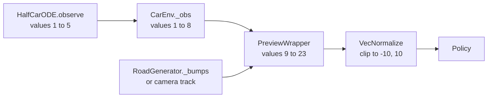

# Observation space

`Box(23,)`: 8 vehicle values from `CarEnv` and 15 road-ahead values appended by `PreviewWrapper`, given to the policy once per bump.

## This implements

- `_obs` in `src/gym_env/common/car_env.py`: vehicle values and the three speed values.
- `observe` in the two `ode_model.py` files: the body values. Bounds `OBS_LOW`, `OBS_HIGH` in `src/gym_env/half_car/config/env_params.py` (quarter-car: `config/gym_env/env.yaml`). The environment does not clip to them.
- `PreviewWrapper` (`src/gym_env/common/preview/preview.py`): the three-bump preview, perception modes `none`, `replay`, `model`.
- Stable-Baselines3 `VecNormalize` (`src/train/environment.py`).

## Inputs and outputs

Reads:
- the vehicle state, speed and the speed of the last step, the bump list of the road (or the camera detections of a recorded scenario).

Returns:
- 23 values (half-car) or 21 (quarter-car, no pitch values 4 and 5), observed at the first 20 ms step of the slowdown window, 25 m before the bump (see [Action-Space](Action-Space)).

The 23 values

Values 1 to 8 are SI values. Values 9 to 23 are scaled to 0 to 1 and clipped.

| No. | Name | Definition | Unit | Range |
|---|---|---|---|---|
| 1 | Front wheel relative velocity | front wheel vertical velocity minus body heave velocity | m/s | -10 to 10 |
| 2 | Front wheel acceleration | vertical acceleration of the front wheel | m/s² | -300 to 300 |
| 3 | Body acceleration | heave acceleration of the body, unweighted | m/s² | -20 to 20 |
| 4 | Pitch acceleration | angular acceleration of the pitch | rad/s² | -50 to 50 |
| 5 | Pitch rate | angular velocity of the pitch | rad/s | -5 to 5 |
| 6 | Speed | current speed $v$ | m/s | 0 to 20 |
| 7 | Longitudinal acceleration | of the last 20 ms step | m/s² | -5 to 5 |
| 8 | Speed error | $v_\text{top} - v$ | m/s | -20 to 20 |
| 9 to 12 | Bump 1 | distance, length, height, frequency | 1 | 0 to 1 |
| 13 to 16 | Bump 2 | the same four values | 1 | 0 to 1 |
| 17 to 20 | Bump 3 | the same four values | 1 | 0 to 1 |
| 21 | Speed ratio | $v / v_\text{top}$ | 1 | 0 to 1 |
| 22 | Distance since last bump | end of the last passed bump to the front axle, divided by 40 m; 1 if none passed | 1 | 0 to 1 |
| 23 | On-bump flag | 1 while the front axle is on a bump | 1 | 0 or 1 |

$v_\text{top}$ is the top speed of the episode, at least the 5 km/h floor.

Bump values for distance $d$ (0 on a bump), length $L$, height $A$, each clipped to 0 to 1:

$$\frac{d}{D}, \qquad \frac{L}{L_\text{clip}}, \qquad \frac{A}{A_\text{clip}}, \qquad \frac{v_\text{top}/L}{F_\text{clip}}$$

with $D$ = `preview_distance`, $L_\text{clip}$ = `length_clip`, $A_\text{clip}$ = `h_clip` and $F_\text{clip}$ = `freq_clip`.

The frequency uses the top speed, so it describes the bump as it would be met without slowing. An empty slot is $(1, 0, 0, 0)$. Bumps start at most `preview_distance` ahead and the front axle has not passed their end, nearest first. Holes (negative height) are not listed.

Normalisation: $\mathrm{clip}\big((o - \mu)/\sqrt{\sigma^2 + \epsilon},\ -10,\ 10\big)$ with $\epsilon = 10^{-8}$ and `clip_obs` 10. The statistics are saved next to the model as `vecnormalize.pkl` and frozen for evaluation. `utils.portable` writes `vecnormalize.json` for the safetensors format.

## Parameters

In `config/preview/preview.yaml`: `[min, max, default]`.

Parameter list

- `perception_mode`: source of the bump values: `none` (exact geometry, final setup), `replay` (stored camera detections), `model` (stored detections, else a detection probability and range bias per distance bin from `config/perception/perception_model.yaml`) [-, -, `none`]
- `preview_distance`: look-ahead in m [0, inf, 40.0]
- `n_peaks`: bumps listed; the vector has 4 `n_peaks` + 11 values in `v2` [1, inf, 3]
- `length_clip`: length divisor in m [0, inf, 8.0]
- `h_clip`: height divisor in m [0, inf, 0.15]
- `freq_clip`: frequency divisor in Hz [0, inf, 10.0]
- `peak_height_min`: smallest bump height listed, in m [0, inf, 0.01]
- `noise_active`: Gaussian noise in mode `none` [False, True, False]
- `noise_distance_std`, `noise_height_std`, `noise_width_std`: noise standard deviations in m [0, inf, 0.5, 0.005, 0.05]
- `features`: `v2` (this layout) or `v1` (older, three values per bump; then `source`, `dense_n`, `pt1_tau`, `use_dist_obs`, `freq_max` apply) [-, -, `v2`]

## Notes

> [!NOTE]
> A policy needs its own `vecnormalize.pkl`: the same raw observation gives another action with other statistics.

See also: [Gymnasium-Environment](Gymnasium-Environment), [Scenarios](Scenarios), [PPO-Training](PPO-Training)
