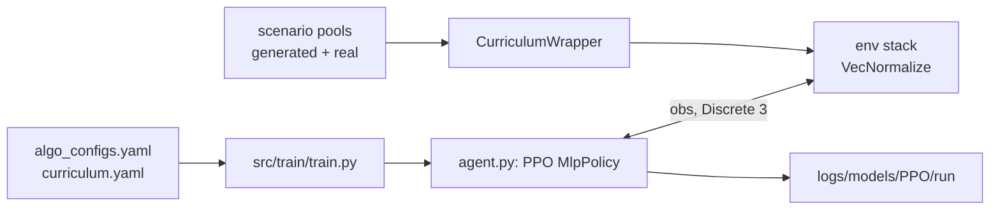

# PPO training

`calm train` trains the speed-planning policy with Stable-Baselines3 PPO on the half-car environment, through a four-level [curriculum](Curriculum).



## This implements

- `src/train/train.py`: arguments, run folder, callbacks, final save, `summary.json`
- `src/train/agent.py`: builds `PPO`, parses the `lin_` learning rate, loads a model for `--resume`
- `src/train/environment.py`: wrapper stack, vectorized training and evaluation environments, `VecNormalize`
- `src/train/monitoring.py`: curriculum evaluation, checkpoints, TensorBoard metrics, validation on real roads
- `src/utils/portable.py`: pickle-free export and loading
- one training step is one decision (one bump); the wrappers repeat the action in between ([Action space](Action-Space))

## Inputs and outputs

Reads:
- `config/agent/algo_configs.yaml`, `config/curriculum/curriculum.yaml`, `config/reward/reward.yaml`, `config/preview/preview.yaml`
- the scenario pools in `config/train/scenarios/`

Writes `logs/models/PPO/<run>/` (`exp_<n>` with the next free number when `--run-name` is not given):
```
PPO_final.zip, vecnormalize.pkl       end of the run, also after Ctrl+C or a crash
best/best_model.zip, evaluations.npz  best mean evaluation return, evaluation history
best/level_<n>/best_model.zip         best model per curriculum level (+ best_model_vec_normalize.pkl)
best_real/best_model.zip              best return on 20 real training roads, checked every 2nd evaluation
checkpoints/ckpt_<steps>_steps.zip    with ckpt_vecnormalize_<steps>_steps.pkl
summary.json                          status, config, paths, evaluation curve, per-level report
```
TensorBoard logs go to `logs/tensorboard/<run>/` (`calm tb`), episode CSVs to `logs/monitor/<run>/`.

## Parameters

Legend: `name`: meaning [default]. File `config/agent/algo_configs.yaml`, block `PPO`, passed to `stable_baselines3.PPO` unchanged.

- `net_arch`: separate actor and critic, `ReLU`, `ortho_init` [`pi: [256, 128]`, `vf: [256, 256]`]
- `learning_rate`: `lin_<start>_<end>`, linear over the run [`lin_3e-4_5e-5`]
- `n_steps`: decisions per environment per update [64]
- `batch_size`, `n_epochs`: [128, 4]
- `gamma`, `gae_lambda`: [1.0, 1.0]
- `clip_range`, `clip_range_vf`, `target_kl`: [0.2, 0.2, 0.02]
- `ent_coef`, `vf_coef`, `max_grad_norm`: [0.3, 0.5, 0.5]

<details><summary>Block <code>training</code> in the same file</summary>

- `total_timesteps`: decisions, overridden by `--timesteps` [20000]
- `n_envs`: training environments, overridden by `--n-envs` [4]
- `eval_freq`: decisions between evaluations [2000]
- `n_eval_episodes`: deterministic episodes per evaluation [30]
- `checkpoint_freq`: decisions between checkpoints [4000]
- `norm_reward`: `VecNormalize` reward scaling; observation scaling is always on [true]
- `subproc`: `SubprocVecEnv` with `fork`; falls back to `DummyVecEnv` without `fork` or with one environment [true]
- `VecNormalize` uses `clip_obs` 10, `clip_reward` 10. The evaluation environment shares the observation statistics and does not scale rewards.
- seeds: training environment `i` gets `seed + i`, evaluation `seed + 10000`, real validation `seed + 20000`
</details>

## Basic use

```bash
calm train --run-name demo -m "first run"
calm train --run-name demo2 --timesteps 40000 --n-envs 8 --start-level 1
```

- `--vehicle`: `half` or `quarter` [`half`]
- `--seed`: random seed [`training.seed` in `config/agent/algo_configs.yaml`, 69]
- `--timesteps`, `--n-envs`: override the yaml
- `--run-name`: run folder name [`exp_<n>`]
- `--start-level`: first curriculum level; the top level pins the policy there [0]
- `--resume`: checkpoint `.zip` to continue from; `--timesteps` then counts additional decisions
- `--sparse-reward`: pay the whole episode return at the episode end (`TerminalRewardWrapper`)
- `-m`, `--message`: saved as `comment.txt` in the run folder

## Export without pickle

```bash
PYTHONPATH=src python -m utils.portable logs/models/PPO/demo/PPO_final.zip logs/models/PPO/demo/vecnormalize.pkl --out out/
```

- `policy.safetensors`: the policy `state_dict`
- `vecnormalize.json`: `obs_mean`, `obs_var`, `obs_count`, `clip_obs`, `epsilon`, `norm_obs`; reward statistics are not exported
- `load_policy` rebuilds `PPO('MlpPolicy', ...)` from `policy_kwargs` in `algo_configs.yaml`, so the network shape in the config must match the file
- [CALM-PPO](https://huggingface.co/CALM-Dataset/CALM-PPO) holds both formats, the training configs and four more seeds (68, 70, 71, 72) in `seeds/`

See also: [Curriculum](Curriculum), [Reward function](Reward-Function), [Observation space](Observation-Space), [Evaluation](Evaluation), [Command line](Command-Line)
