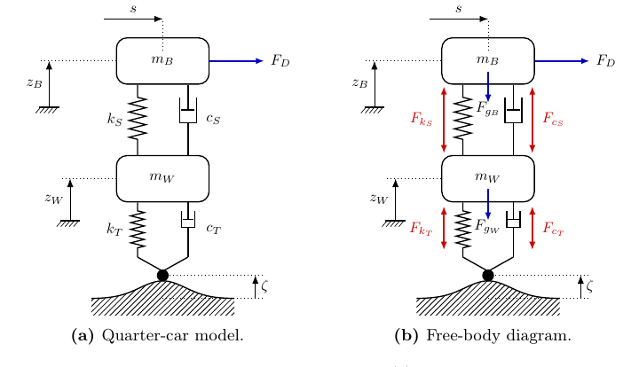
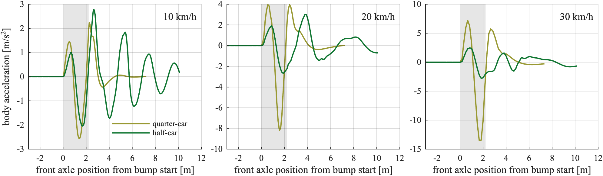

# Quarter-car model

`QuarterCarODE` is the one-corner vehicle: a sprung mass on a nonlinear suspension, an unsprung mass on a tire. Select it with `--vehicle quarter`, id `gym_env/QuarterCar`.

   
  <em>Quarter-car: sprung mass mB, unsprung mass mW, suspension (kS, cS), tire (kT, cT) and road height ζ (from the BSc thesis).</em>

## This implements

- `QuarterCarODE` in `src/gym_env/quarter_car/core/ode_model.py`: `_ode`, `_spring_nonlin`, `_damper`, `_rk4_loop`, `step`, `observe`, `crash_signals`.
- `PHYSICS` and the observation bounds in `src/gym_env/quarter_car/config/env_params.py` (bounds from `config/gym_env/env.yaml`).
- `QuarterCarEnv`, registration and rendering in `src/gym_env/quarter_car/envs/`.

State vector (6):

- 0: tire deflection [m]
- 1: wheel vertical velocity [m/s]
- 2: suspension deflection, wheel minus body, positive in compression [m]
- 3: body heave velocity [m/s]
- 4: speed $v$, no dynamics, set by the environment [m/s]
- 5: body heave displacement [m]

## Equations

With $\delta_S = z_W - z_B$, $v_S = \dot z_W - \dot z_B$, $\delta_T = \zeta - z_W$:

$$m_B\,\ddot z_B = F_S, \qquad m_W\,\ddot z_W = -F_S + k_T\,\delta_T + c_T(\dot\zeta - \dot z_W), \qquad F_S = k_S\,\delta_S + F^{nl}_S(\delta_S) + F_C(v_S)$$

The bump stops $F^{nl}_S$ and the damper $F_C$ are the same functions as in [Half-Car-Model](Half-Car-Model). Static deflection $\delta_{st} = m_B\,g / k_S$. The input $\dot\zeta$ is the road velocity at the front wheel position.

## Inputs and outputs

`QuarterCarODE.step` takes:
- the state, the road, the position $s$ and the speed $v$. The longitudinal acceleration does not enter the dynamics.

and returns:
- the new state, the body acceleration, 0 for the pitch acceleration, the wheel acceleration twice.

Observation (21 values with the 15 preview values, see [Observation-Space](Observation-Space)): values 1 to 3 are wheel minus body velocity, wheel acceleration, body acceleration, then speed, longitudinal acceleration and speed error. Bounds are `OBS_LOW` and `OBS_HIGH` in `config/gym_env/env.yaml`. `crash_signals` are the suspension deflection, the body displacement and the wheel-body velocity.

## Parameters

In `config/gym_env/env.yaml`: `name`: meaning [min, max, default].

Parameter list

- `m_B`, `m_W`: body, wheel mass in kg [0, inf, 465.7, 50.4]
- `k_S`: suspension stiffness in N/m [0, inf, 27922]
- `D`: mean damping in N s/m [0, inf, 3530]
- `A`: compression to rebound damping ratio [0, 1, 0.5]
- `v_d`, `v_z`: damper knee velocities in m/s [0, inf, 0.2, 0.2]
- `k_T`, `c_T`: tire stiffness in N/m, damping in N s/m [0, inf, 262200, 500]
- `dz_cmp`, `dz_rbd`: bump-stop clearances in m [0, inf, 0.02, 0.08]
- `f1_cmp`, `f2_cmp`, `f1_rbd`, `f2_rbd`: bump-stop shape [0, inf, 1/3, 4, 1, 8]
- `F_ks_nlin_max`: bump-stop force clip in N [0, inf, 100000]

The quarter-car runs with these nominal values. `plant_k_S_scale` and `plant_D_scale` apply only to the half-car.

## Integration

RK4 with `DT_SIM` = 1 ms, 20 sub-steps per 20 ms control step, speed constant. The road velocity is sampled at the start, middle and end of each sub-step. Compiled with Numba.

   
  <em>Body acceleration of the quarter-car and the half-car over one bump at 10, 20 and 30 km/h.</em>

See also: [Vehicle-Models](Vehicle-Models), [Half-Car-Model](Half-Car-Model), [Observation-Space](Observation-Space)
