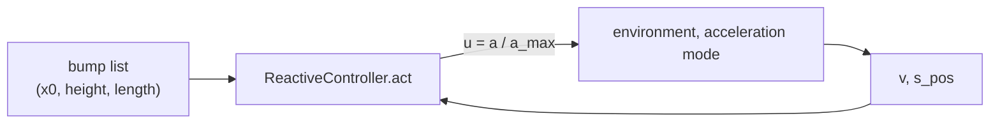

# Reactive driver

A rule-based planner that slows for each bump by how steep it looks. It has no vehicle model and solves no optimisation.



## This implements

- `ReactiveController` in `src/baseline/reactive_driver/driver.py`: `act(x, s_pos, road)` returns `u`
- `calm reactive` in `driver_eval.py`, episode loop shared with the MPC (`src/baseline/runner.py`)
- severity from steepness, braking so that the crossing speed is reached at the bump, acceleration afterwards

Rules, for a bump of height `H` and width `W`:

```
severity = clip(|H| / W / steep_full_slow, 0, 1)      (at least hole_severity if H < 0)
v_cross  = v_max - severity * (v_max - v_min)
```

For every bump not yet passed, the driver asks for braking when:
- the car is on the bump (`x0 <= s_pos < x0 + W`) and `v > v_cross`, or
- the bump is within the preview distance, `v > v_cross`, and the distance is at most `(v^2 - v_cross^2) / (2 a_brake) + brake_margin`

The command is `-a_brake` if any bump asks for braking. Otherwise 0 while on a bump, `+a_accel` while `v < v_max`, 0 at `v_max`.

## Inputs and outputs

- reads speed `v`, position `s_pos`, and `(x0, height, length)` for each bump of the road
- outputs normalised acceleration `u` in [-1, 1], `a_max` = 5 m/s2
- results in `logs/eval/results/reactive_driver/<scenario>/`: `summary.json` for one road, `suite_reactive_<time>.json` for suites

## Parameters

Legend: `name`: meaning [default]. Files as named.

- `steep_full_slow`: height over width at which the car slows all the way [0.05], `config/baseline/reactive_driver.yaml`
- `hole_severity`: minimum severity of a pothole [0.60], same file
- `brake_margin`: extra distance before the braking point, m [3.0], same file
- `a_brake`, `a_accel`: m/s2 [2.0, 2.0], `eval.a_comfort` in `config/reward/reward.yaml`
- `v_max`: km/h, capped at the road speed of the episode [35], `velocity.v_limit` in `reward.yaml`
- `v_min`: km/h [8], `velocity.v_min` in `reward.yaml`
- `preview_distance`: m [40], `config/preview/preview.yaml` or `--preview`

## Basic use

```bash
calm reactive --scenario c
calm reactive --suites 10_potholes
```

- `--scenario`: one road; the true geometry is used
- `--suites`: suite folders, `real`, `real_train`, `real_all`, `flat`
- `--no-perception`: true road on suites instead of camera detections
- `--preview`: preview distance in m
- `--vehicle`, `--seed`, `--render`, `--save-gif`, `--save-plots`

See also: [MPC planner](MPC-Planner), [Evaluation](Evaluation), [Scenarios](Scenarios)
