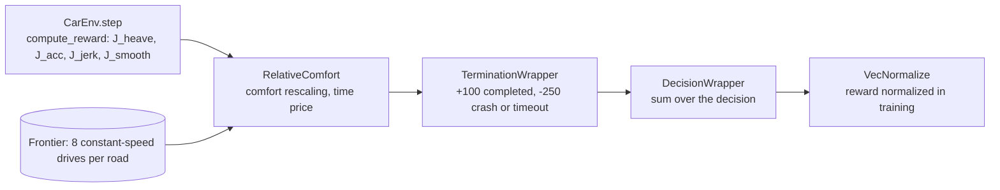

# Reward function

The per-step reward penalizes Wk-weighted body acceleration and the longitudinal acceleration of the speed change. In training, `RelativeComfort` rescales it against constant-speed drives on the same road.

## This implements

- `compute_reward` and `compute_terminal_reward` in `src/gym_env/common/reward/reward.py`.
- `RewardConfig` in `src/gym_env/common/reward/reward_params.py`, loaded from `config/reward/reward.yaml`.
- `RelativeComfort` (`src/gym_env/common/wrappers/relative_comfort.py`): reference drives, frontier, time price. Training only.
- Crash penalty and completion bonus in `src/gym_env/common/wrappers/termination.py`.
- `WkStream` in `src/eval/iso2631.py`: the Wk filter on the body acceleration.

## Inputs and outputs

Reads:
- body acceleration $\ddot z_B$, the longitudinal acceleration $a$ of this and the previous step, $g$ = 9.81, the termination reason.

Returns:
- one scalar per 20 ms step, the weighted terms in `info` (`J_heave`, `J_long_acc`, `J_long_jerk`, `J_act_smooth`, `J_total`).

$$r_t = Q_{zB}\,J_\text{heave} + Q_a\,J_\text{acc} + w_\text{jerk}\,J_\text{jerk} + w_\text{smooth}\,J_\text{smooth}$$

- $J_\text{heave} = -(\ddot z_{B,\text{Wk}} / g)^2$, Wk-weighted when `wk_heave`.
- $J_\text{acc} = -(a / g)^2$.
- $J_\text{jerk} = -((a_t - a_{t-1}) / g)^2$.
- $J_\text{smooth} = -((a_t - a_{t-1}) / a_\max)^2$.
- Wheel and pitch terms, $-(\ddot z_W / g)^2$ and $-(l\,\ddot\varphi / g)^2$, are off in the final setup (`Q_zWddot`, `Q_pitch` = 0).

`RelativeComfort` drives the road at each reset with the hold action at 8 constant speeds from `v_hard_min` to the top speed. Each drive gives a trip time $T$ and heave cost $C = -\sum J_\text{heave}$. The fastest drive gives $T_h$ and $J_h = \max(C, c_\text{min})$. Results are cached per road. Symbols: $\kappa$ is `rel_scale`, $c_\text{min}$ is `rel_min_cost`, $\lambda_1$ is `rel_time_price`, $\lambda_2$ is `rel_time_quad`.

- Comfort rescaling: $r \leftarrow r + J_\text{heave}\,(\kappa/J_h - 1)$.
- Linear time price: $r \leftarrow r - \lambda_1\cdot\kappa\cdot \Delta t / T_h$.
- Quadratic time price: $r \leftarrow r - \lambda_2\cdot\kappa\,(\text{lag}/T_h)^2\,\Delta t / T_h$, with $\text{lag} = \max(t - s/v_\text{top},\,0)$.
- Frontier correction at `completed`: $r \leftarrow r - \kappa\; C_\text{ep}\,\big(1/C_\text{eq}(T) - 1/J_h\big)$. $C_\text{ep}$ is the heave cost of the episode, $C_\text{eq}(T)$ the frontier cost interpolated at the trip time $T$ (at least `rel_min_cost`). The comfort part of the episode sums to $-\kappa\cdot C_\text{ep}/C_\text{eq}(T)$.

## Parameters

In `config/reward/reward.yaml`: `[min, max, default]`.

Parameter list

- `weights.Q_zBddot`: weight $Q_{zB}$ of $J_\text{heave}$ [0, inf, 50]
- `weights.wk_heave`: Wk-weight the heave acceleration [False, True, True]
- `weights.Q_a`: weight $Q_a$ of $J_\text{acc}$ [0, inf, 0.2]
- `weights.w_jerk`: weight of $J_\text{jerk}$ [0, inf, 0.4]
- `weights.w_action_smooth`: weight of $J_\text{smooth}$ [0, inf, 0.2]
- `weights.Q_zWddot`, `weights.Q_pitch`: wheel and pitch weights [0, inf, 0, 0]
- `weights.pitch_arm`, `weights.pitch_clip`: lever arm $l$ in m, clip in rad/s² [0, inf, 1.3, 30]
- `weights.Q_v`, `weights.track_scale`: speed tracking $-\lvert v - v_\text{top}\rvert / v_\text{top}$ times both [0, inf, 1.0, 0] (off)
- `weights.Q_step`, `weights.time_cost`: constant per step, per second [0, inf, 0, 0]
- `weights.rel_scale`: `RelativeComfort` scale; 0 switches the wrapper off [0, inf, 100]
- `weights.rel_frontier`: end-of-episode frontier correction [False, True, True]
- `weights.rel_time_quad`: quadratic time price [0, inf, 0.9]
- `weights.rel_time_price`: linear time price [0, inf, 0.0]
- `weights.rel_min_cost`: lower bound on the reference costs [0, inf, 1.0]
- `terminal.bonus`: reward at `completed`, plus `Q_t` times 100 times the unused time fraction [-, -, 100]
- `terminal.penalty`: reward at `crash_*` and `timeout` [-, -, -250]
- `terminal.Q_t`: weight of the unused time fraction [0, inf, 0]
- `terminal.v_min`, `terminal.v_max`: speed bounds of `crash_speed`, m/s [0, inf, 0, 18.1]
- `terminal.a_limit`: acceleration for the `comfort_score` in `info`, m/s² [0, inf, 5.0]
- `velocity.a_max`: m/s² [0, inf, 5.0]
- `velocity.v_limit`, `v_min`, `v_hard_min`, `v_init_low`: speeds in km/h [0, inf, 35, 8, 5, 8]
- `vertical.g`, `vertical.heave_clip`, `vertical.wheel_clip`: [-, -, 9.81, 1e9, 1e9] (1e9 means no clipping)

See also: [Gymnasium-Environment](Gymnasium-Environment), [Episodes-and-Termination](Episodes-and-Termination), [Comfort-Metric](Comfort-Metric), [PPO-Training](PPO-Training)
