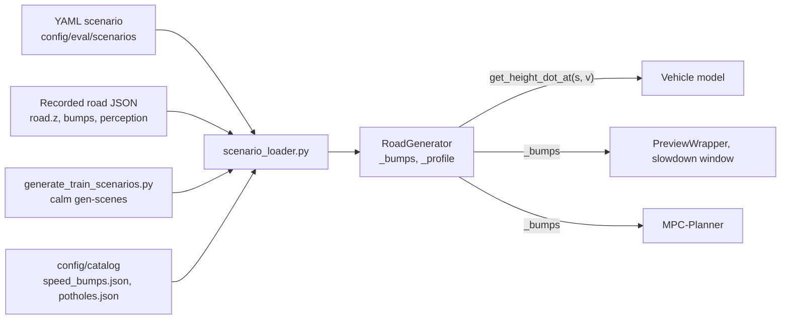

# Roads and bumps

Every road is a `RoadGenerator` in `src/road/road_generator.py`: a list of raised-cosine bumps or a measured height profile, and 0 everywhere else.

## This implements

- `RoadGenerator` with constructors `from_random`, `from_scenario`, `from_profile` and queries for height and slope.
- Bump list `_bumps`: tuples `(x0, H, W)` for catalog bumps, potholes and generated roads.
- Profile: grid `s`, height `z`, slope `dz/ds` (`numpy.gradient`, interpolated) for recorded crossings, `flat30`, `flat50`. `_bumps` then holds the labelled bumps.
- Edge trimming of recorded profiles and `_trim_offset_m` (`src/utils/scenario_loader.py`).
- Catalogs `config/catalog/speed_bumps.json` (ids 5 to 9) and `potholes.json` (ids 0 to 4), referred to by `catalog_id`.

A bump of height $H$ and width $W$ is a raised cosine. A pothole is the same with $H < 0$. The models read the road velocity $\dot\zeta$, so the input grows with speed:

$$\zeta(s) = \frac{H}{2}\left[1 - \cos\frac{2\pi (s - x_0)}{W}\right], \quad x_0 \le s \le x_0 + W, \qquad \dot\zeta = \frac{d\zeta}{ds}\,v, \quad \frac{d\zeta}{ds} = \frac{\pi H}{W}\sin\frac{2\pi (s - x_0)}{W}$$

`set_speed` caps the speed so that the largest $\dot\zeta$ stays below 7 m/s.

## Inputs and outputs

Reads:
- a scenario YAML (`obstacles` with `height_m`, `width_m` or `catalog_id`, `x_start_m`, `vehicle_speed_kmh`) or a recorded road JSON from [Scenarios](Scenarios): `road.z` on a 0.05 m grid, `bumps` (`s_bump_m`, `s_start_m`, `s_end_m`, `peak_z_m`, `width_m`, flags), `perception` track.

Returns:
- `get_height_dot_at(s, v)` to the vehicle model, once per wheel (front at $s$, rear at $s - L$).
- `_bumps` to the preview, the slowdown window, `bumps_passed` and the MPC. Potholes are counted in `holes_total` and not listed in the preview.

Catalog obstacles and scenario keys

| Obstacle | Height or depth | Width | Scenario |
|---|---|---|---|
| short bump | 25 mm | 0.92 m | `s` |
| medium bump | 62.5 mm | 2.22 m | `m` |
| severe bump | 100 mm | 1.00 m | `sv` |
| long bump | 125 mm | 9.50 m | `l` |
| raised crosswalk | 100 mm | 5.00 m | `c` |
| pothole minor, shallow, moderate, severe, critical | 15, 25, 40, 70, 100 mm | 0.30, 0.40, 0.60, 0.90, 1.20 m | `hmi`, `hsh`, `hmo`, `hsv`, `hcr` |

The YAML scenarios in `config/eval/scenarios/01_single_bump/` and `10_potholes/` start the obstacle at `x_start_m: 40.0` and drive at `vehicle_speed_kmh: 30.0`.

## Parameters

Trimming of recorded profiles, `config/gym_env/scenario_trim.yaml`: `[min, max, default]`.

- `trim_edges`: cut profiles that do not start or end level [False, True, True]
- `edge_tol_m`: a profile end is level within this height in m [0, inf, 0.01]
- `bump_margin_m`: the cut keeps this distance before the first and after the last bump, in m [0, inf, 0.5]

Generated training roads, `config/train/scenario_gen.yaml` (`calm gen-scenes`):

- `v_min_kmh`, `v_max_kmh`: speed range in km/h [0, inf, 15.0, 30.0]
- `flat_start_range`: flat run-up in m [0, inf, `[10.0, 20.0]`]
- `real_range.height_mm`, `real_range.width_m`: size range, drawn log-uniform [0, inf, `[30, 120]`, `[1.5, 7.0]`]
- `per_level`: roads per difficulty (easy, medium, hard, expert) [1, inf, 200]

Each generated road has one bump. `from_random`, the fallback in `reset`, draws one of the first five catalog entries by list position with a flat run-up. See [Curriculum](Curriculum).

See also: [Gymnasium-Environment](Gymnasium-Environment), [Observation-Space](Observation-Space), [Vehicle-Models](Vehicle-Models), [Scenarios](Scenarios), [Dataset-Format](Dataset-Format)
