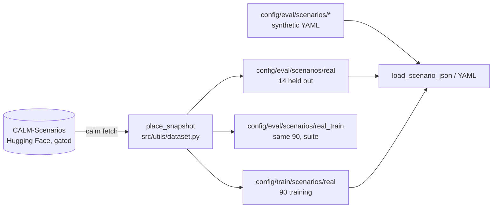

# Scenarios

The roads CALM drives on: synthetic suites shipped in the repository and real crossings of speed bumps from CALM-Scenarios.



## This implements

- 10 synthetic roads in two suites, 30 km/h, obstacle at 40 m
- 105 qualified real crossings (64 Germany, 41 Italy): 14 held out for evaluation, 90 for training, `augsburg_sb06` excluded
- `calm fetch` (`just fetch-scenarios`): download and placement by `ensure_local` in `src/utils/dataset.py`
- trimming of the profile on load (`config/gym_env/scenario_trim.yaml`)

Synthetic suites, `config/eval/scenarios/<suite>/`, sizes from `config/catalog/speed_bumps.json` and `potholes.json`:

| Suite | Codes: height x width |
|---|---|
| `01_single_bump` | `s` 2.5 cm x 0.92 m, `m` 6.25 cm x 2.22 m, `l` 12.5 cm x 9.5 m, `c` 10 cm x 5.0 m (crosswalk), `sv` 10 cm x 1.0 m |
| `10_potholes` | `hmi` -1.5 cm x 0.30 m, `hsh` -2.5 cm x 0.40 m, `hmo` -4 cm x 0.60 m, `hsv` -7 cm x 0.90 m, `hcr` -10 cm x 1.20 m |

A scenario YAML has `name`, `description`, `vehicle_speed_kmh` and `road_obstacles` (each `x_start_m` plus `height_m` and `width_m`, or a `catalog_id`). A negative height is a pothole.

## Inputs and outputs

Local layout after `calm fetch`:

```
config/
├── eval/scenarios/
│   ├── 01_single_bump/, 10_potholes/     synthetic, in the repository
│   ├── real/                             14 held-out crossings (suite real)
│   └── real_train/                       the 90 training crossings (suite real_train)
├── train/scenarios/real/                 the 90 training crossings, drawn by the curriculum
└── perception/perception_model.yaml      first model found of de_it, de, it; written only if absent
```

Hugging Face layout of CALM-Scenarios (CC BY-NC 4.0, gated):

```
germany/crossings/, italy/crossings/       one JSON per crossing (114 and 45)
germany/perception_model/, italy/perception_model/, perception_model_de_it.yaml
synthetic/                                 the synthetic roads and KEY.md
split.yaml
```

Fields of the crossing JSON are on [Dataset format](Dataset-Format).

`split.yaml`:
- `eval`: the 14 held-out roads
- `exclude`: `augsburg_sb06`, the same bump as the held-out `augsburg_sb13` driven the other way

## Basic use

```bash
calm fetch
calm eval demo --suites real
calm eval demo --scenario augsburg_sb13
```

- `--scenario` takes a synthetic name, a crossing name (looked up in `real`, then `real_train`), `flat30` or `flat50` (200 m flat road at that speed), or a YAML or JSON path
- `--suites` takes folder names and `real`, `real_train`, `real_all` (both), `flat`. `config/eval/eval_suites.yaml` sets the default suites (`real` on, `01_single_bump` off).
- a new road: put the file in a new folder such as `config/eval/scenarios/20_custom/` and use `--suites 20_custom`

`calm fetch` skips crossings under `exclude` and every crossing whose first bump has `low_confidence: true`, and prints the skipped count. A crossing is evaluation if its name is in `eval`, else training. Both lists naming one crossing is an error. Without an `eval` list the `train/` and `eval/` folders of the region decide.

> [!NOTE]
> If all three real folders already hold JSON files, `calm fetch` does nothing. Delete them to download again. Without access it stops with a message to request access and run `hf auth login`.

See also: [Dataset format](Dataset-Format), [Roads and bumps](Roads-and-Bumps), [Curriculum](Curriculum), [Evaluation](Evaluation)
