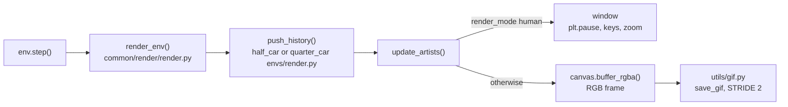
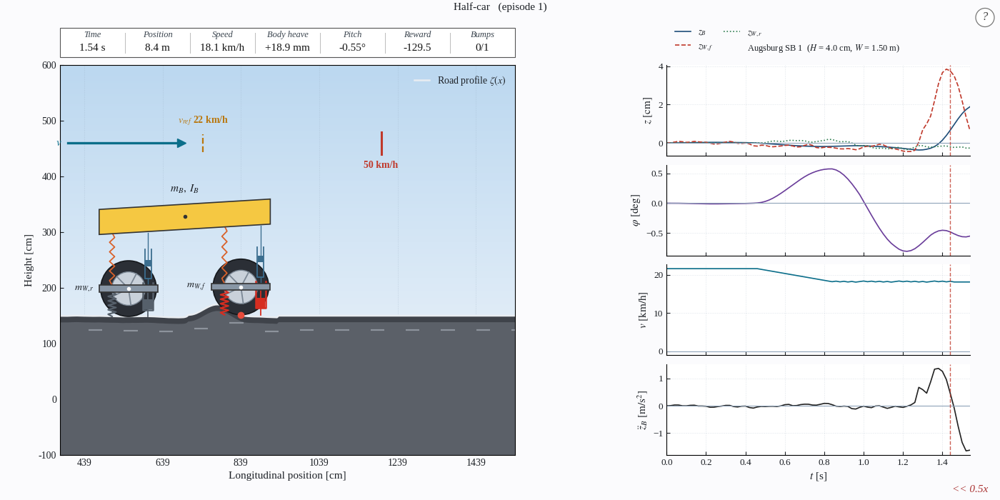

# Simulator

The Matplotlib render window of the Gymnasium environment: the vehicle on the road at the left, time series at the right.


*Every environment step appends to the history and redraws. A window or an RGB frame comes out.*

<p align="center">
  <br>
  <em>The half-car simulator over a 4 cm bump from Augsburg.</em>
</p>

## Panels

- Header table: Time (s), Position (m), Speed (km/h), Body heave (mm), Pitch (degrees, half-car only), Reward (sum so far), Bumps (passed out of total, for example `0/1`).
- Scene: body, suspension, wheels, road profile, speed arrow, `v_ref` tick (scenario speed), red tick at the 50 km/h limit.
- Height plot: body heave `z_B`, front wheel `z_W,f`, rear wheel `z_W,r` in cm (quarter-car: `z_B` and `z_W`).
- Pitch plot: `phi` in degrees (half-car only).
- Speed plot: `v` in km/h.
- Acceleration plot: vertical body acceleration, the signal of the comfort metric.
- Bump line: dashed vertical line when the front wheel reaches a bump; the legend gives its name, height `H` and width `W`.
- Corner label: `>> 2x`, `<< 0.5x`, `|| paused`; empty at real time.

## Launch

```bash
calm eval <run> --scenario c --render
calm eval <run> --suites real --render
calm mpc --scenario nardo_sb01 --render
calm reactive --scenario c --render
```

- `calm mpc --render` and `calm reactive --render` without `--scenario` step through the enabled suites.
- `--vehicle quarter` selects the quarter-car; the policy must be a quarter-car policy.
- The window opens full screen and playback starts at 0.5x.

## Keys

Click into the window if the keys do not react. Matplotlib's default shortcuts are removed while it is open.

- `space`: pause or resume; continues after an episode ended.
- `f`, `s`: faster, slower along 0.1, 0.25, 0.5, 1, 2, 4, 8, 16.
- `+` or `=`, `-`, scroll wheel: zoom (factor 1.25, range 0.3x to 6x). `0` resets.
- Right arrow: next scenario, or next episode for a single scenario.
- Left arrow: previous scenario in `calm mpc` and `calm reactive`; in `calm eval` it restarts the current scenario.
- `r`: replay the current scenario.
- `q`, `escape`: quit. Closing the window does the same.

## GIF export

```bash
calm eval <run> --scenario c --save-gif
calm mpc --scenario nardo_sb01 --save-gif
```

- Do not combine `--save-gif` with `--render`: no frames are captured while the live window is open.
- `calm mpc` and `calm reactive` write a GIF only for a single `--scenario`.
- `--save-plots` writes the time series as PNG to the same folders.
- Paths: `logs/eval/results/eval_PPO_<name>_run/ep<N>.gif`, `.../eval_PPO_suite_run/<suite>/<scenario>.gif`, `logs/eval/results/mpc/<name>/mpc_ep1.gif`, `logs/eval/results/reactive_driver/<name>/reactive_driver_ep1.gif`.

## Parameters

Config: `config/gym_env/render.yaml`. Legend: `name`: meaning [default].

- `RENDER_FULLSCREEN`: open full screen [true].
- `RENDER_Y_SCALE`: vertical exaggeration of the scene; zooming out reduces it to 1 [5].
- `RENDER_TOOLBAR`: Matplotlib toolbar [false].
- `RENDER_SHOW_TS`, `RENDER_TS_Z`, `RENDER_TS_SPEED`, `RENDER_TS_Z_DDOT`: switch the plots on and off [true].
- `RENDER_MUSIC`: background music with mute button and volume slider, needs pygame [false].

> [!NOTE]
> While a wheel is on an obstacle, its tire and contact point turn red.

See also: [Command line](Command-Line), [Half-car model](Half-Car-Model), [Comfort metric](Comfort-Metric), [Troubleshooting](Troubleshooting)
