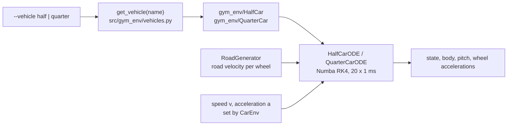

# Vehicle models

CALM has two nonlinear vertical ride models, a half-car (default) and a quarter-car, both driven by the road velocity under each wheel.



## This implements

- `Vehicle` registry `VEHICLES` with `env_id`, modules, `make_ode`, `obs_bounds`, `physics`, `v_index` (`src/gym_env/vehicles.py`).
- `HalfCarODE` and `QuarterCarODE` in `src/gym_env/*/core/ode_model.py`: right-hand side and RK4 loop compiled with Numba.
- Parameters and observation bounds in `src/gym_env/*/config/env_params.py` and `config/gym_env/env.yaml`.
- Live drawing per vehicle in `src/gym_env/*/envs/render.py`.
- Shared parts: linear spring with exponential bump stops (`_spring_nonlin`), asymmetric damper (`_damper`), linear tyre spring and damper without lift-off.

| | [Half-Car-Model](Half-Car-Model) | [Quarter-Car-Model](Quarter-Car-Model) |
|---|---|---|
| States | 11 | 6 |
| Road input | front wheel at $s$, rear wheel at $s - L$ | one wheel |
| Pitch, longitudinal coupling | yes | no |
| Observation | 23 values | 21 values |
| Gymnasium id | `gym_env/HalfCar` | `gym_env/QuarterCar` |
| `--vehicle` | `half` (default) | `quarter` |
| Plant scaling | `plant_k_S_scale` 1.06, `plant_D_scale` 0.16 | none |

## Inputs and outputs

`step(x, road, s, v, a)` takes:
- the state vector, the road, the front axle position $s$, the speed $v$ and the longitudinal acceleration $a$ of the step. The speed has no dynamics, the environment sets it each step.

and returns:
- the new state, the body acceleration, the pitch acceleration, the front and rear wheel acceleration. The quarter-car returns 0 for pitch and its wheel acceleration twice.

## Parameters

Shared suspension keys in `config/gym_env/env.yaml`: `c_T`, `k_T`, `A`, `v_d`, `v_z`, `f1_cmp`, `f2_cmp`, `f1_rbd`, `f2_rbd`, `dz_cmp`, `dz_rbd`, `F_ks_nlin_max`. Values are on the two model pages. Integration: `DT` 0.02 s, `DT_SIM` 0.001 s, speed constant inside the control step.

`physics_params` (a `gym.make` argument) overrides single values: `{"front": {...}, "rear": {...}, "body": {...}}` for the half-car.

## Basic use

```bash
calm train --vehicle half
calm eval  --vehicle quarter
```

- `--vehicle`: `half` (default) or `quarter`. Accepted by `calm train`, `calm eval` and the baseline commands.
- In Python, `get_vehicle("half").env_id` gives the id for `gym.make`.

## Notes

> [!NOTE]
> A policy trained on one vehicle does not run on the other. The MPC and the reactive driver run on the simulator vehicle with `action_mode: acceleration`.

> [!TIP]
> MATLAB and Simulink versions of both models, with a model-accuracy page, are in [ride-models-matlab](https://github.com/CALM-Dataset/ride-models-matlab).

See also: [Gymnasium-Environment](Gymnasium-Environment), [Roads-and-Bumps](Roads-and-Bumps), [Comfort-Metric](Comfort-Metric), [Command-Line](Command-Line)
